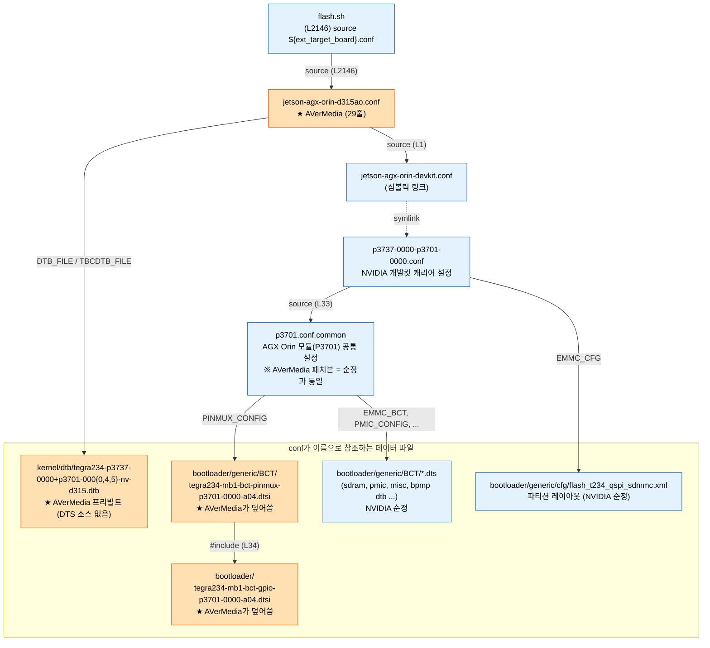
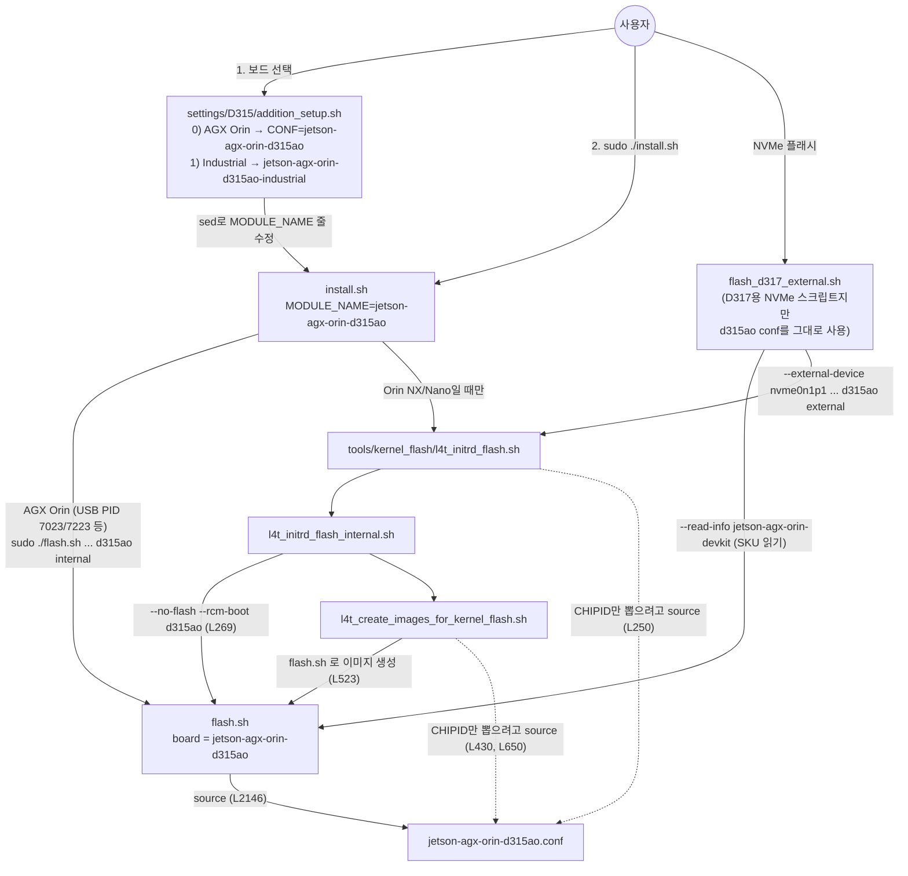
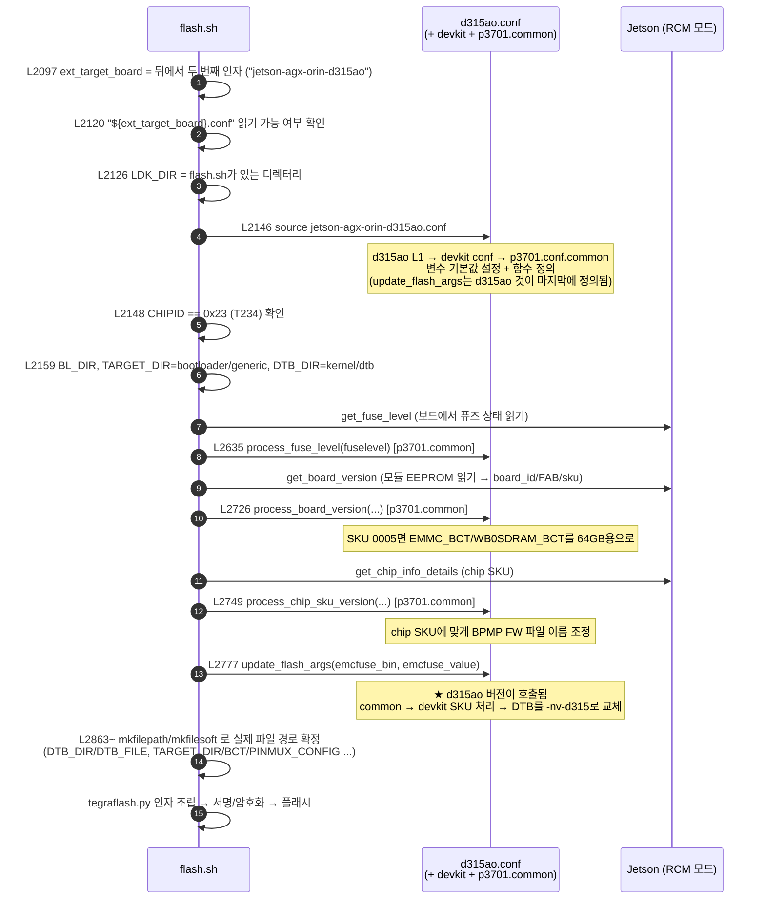
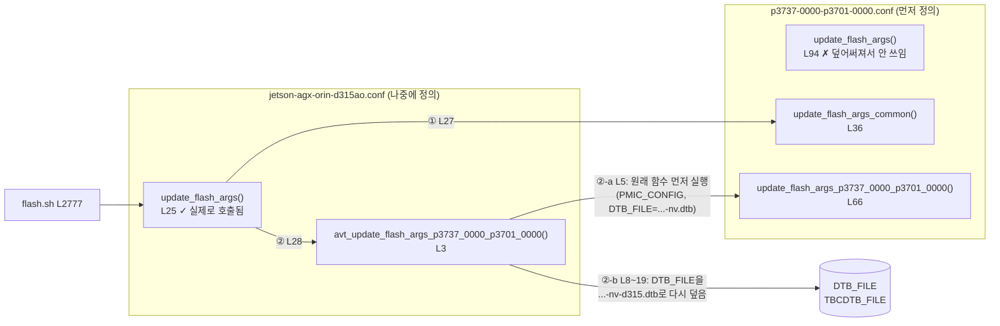

# `jetson-agx-orin-d315ao.conf` 분석 — 의존성 · 호출 관계 · 줄 단위 해석

> 대상 파일
> `AVerMedia/JetPack_6.2.2_Linux_JETSON_desktop_in_docker/Linux_for_Tegra/jetson-agx-orin-d315ao.conf`
> (AVerMedia D315AO 캐리어 공식 BSP, L4T R36.5.0 / JetPack 6.2.2)
>
> 이 문서의 줄 번호·내용은 모두 위 BSP에서 직접 확인했습니다. 순정 비교 대상은
> `~/Downloads/jetson/Jetson_Linux_r36.5.0_aarch64.tbz2`(NVIDIA 순정 L4T R36.5.0)입니다.
> 아래에서 `L4T/`는 `Linux_for_Tegra/`를 줄여 쓴 것입니다.

---

## 0. 한눈에 보기

- **이 파일은 혼자서는 아무것도 하지 않는 bash 조각입니다.** `flash.sh`가 `source`로 읽어 들이며, 직접 실행하지 않습니다.
- 29줄이 전부이고, 하는 일은 **딱 하나**입니다. NVIDIA 개발킷(P3737 캐리어) 설정을 통째로 불러온 뒤, **커널/UEFI가 쓸 DTB 이름만 `-nv-d315.dtb`로 바꿉니다.**
- 바꾸는 방법은 **bash 함수 재정의(override)** 입니다. 개발킷 conf의 `update_flash_args()`를 같은 이름의 함수로 다시 정의해서, `flash.sh`가 개발킷 함수 대신 AVerMedia 함수를 부르게 합니다.
- D315AO 캐리어의 나머지 하드웨어 차이(MB1 pinmux/GPIO)는 **이 파일에 나오지 않습니다.** `settings/D315/patch/`가 순정 파일을 **같은 이름으로 덮어쓰는** 방식으로 들어갑니다(6장).

---

## 1. 파일 의존성 그래프 (누가 누구를 `source` 하나)



주황색은 AVerMedia가 추가하거나 바꾼 파일, 파란색은 NVIDIA 순정 파일입니다.

| 파일 | 출처 | 역할 |
|---|---|---|
| `jetson-agx-orin-d315ao.conf` | AVerMedia 추가 (`settings/D315/patch/`에서 복사) | DTB 이름 교체 |
| `jetson-agx-orin-devkit.conf` → `p3737-0000-p3701-0000.conf` | NVIDIA 순정 | 캐리어(P3737) 설정: 파티션 XML, SKU별 PMIC/BPMP DTB, 오버레이 |
| `p3701.conf.common` | AVerMedia 패치 폴더에 있으나 **순정과 바이트 단위로 같음** (`diff` 결과 차이 없음) | 모듈(P3701) 설정: 부트로더 바이너리, BCT, ODMDATA, 커널 cmdline |
| `*-nv-d315.dtb` | AVerMedia 프리빌트 | 커널/UEFI DTB. **DTS 소스는 BSP와 `source/`에 없음** |
| `tegra234-mb1-bct-pinmux/gpio-p3701-0000-a04.dtsi` | AVerMedia가 순정 파일을 덮어씀 | MB1 단계 핀 설정 (6장) |

---

## 2. 호출 관계 그래프 (누가 이 conf를 쓰게 만드나)



정리하면 이 conf를 쓰는 길은 두 가지입니다.

| 경로 | 명령 | 용도 |
|---|---|---|
| eMMC (기본) | `install.sh` → `sudo ./flash.sh [opts] jetson-agx-orin-d315ao internal` | QSPI 부트로더 + eMMC rootfs |
| NVMe | `flash_d317_external.sh` → `l4t_initrd_flash.sh --external-device nvme0n1p1 ... jetson-agx-orin-d315ao external` | QSPI 부트로더 + NVMe rootfs. `l4t_initrd_flash.sh`는 내부에서 다시 `flash.sh`를 부르므로 결국 같은 conf를 읽음 |

> `install.sh`의 `MODULE_NAME`은 원래 고정값이 아닙니다. `addition_setup.sh`가
> `sed -i "s/\(^MODULE_NAME=\).*/\1${CONF}/g" install.sh`로 고쳐 씁니다. 지금 BSP의 `install.sh`에
> `MODULE_NAME=jetson-agx-orin-d315ao`가 들어 있다는 것은 **0번(일반 AGX Orin)을 이미 골랐다**는 뜻입니다.

---

## 3. `flash.sh` 안에서의 실행 순서 (훅 호출 시퀀스)

conf 파일은 변수 기본값과 **훅 함수**를 정의해 둘 뿐입니다. 언제 무엇을 부를지는 `flash.sh`가 정합니다. 각 훅은 `declare -F`로 함수가 정의돼 있을 때만 호출됩니다.



**핵심은 L2146(source)과 L2777(update_flash_args) 사이에 보드 정보 읽기가 있다는 점입니다.** `board_sku`는 conf를 `source`하는 순간에는 아직 비어 있고, L2726 근처에서 EEPROM을 읽은 뒤에야 채워집니다. 그래서 SKU에 따라 달라지는 값(DTB, PMIC, BPMP DTB)은 conf 최상위 코드가 아니라 **나중에 불리는 함수 안에** 들어 있어야 합니다. d315ao.conf가 DTB 선택을 함수로 만든 이유도 이것입니다.

---

## 4. 함수 재정의(override) 구조

bash에서는 같은 이름의 함수를 다시 정의하면 **나중에 정의한 것이 이깁니다.** d315ao.conf는 L1에서 devkit conf를 먼저 읽고, L25에서 `update_flash_args`를 다시 정의합니다.



원래 함수(`update_flash_args_p3737_0000_p3701_0000`)를 **지우지 않고 먼저 부른 뒤** 결과의 일부(DTB)만 덮어씁니다. 그래서 원래 함수가 정하는 **PMIC 설정(VRS11 DCM 모드)은 그대로 유지**됩니다. NVIDIA 쪽 로직을 복사하지 않고 재사용하는 방식입니다.

---

## 5. 줄 단위 해석

### 5.1 `jetson-agx-orin-d315ao.conf` (전체 29줄)

```bash
 1  source "${LDK_DIR}/jetson-agx-orin-devkit.conf"
 2
 3  avt_update_flash_args_p3737_0000_p3701_0000()
 4  {
 5      update_flash_args_p3737_0000_p3701_0000
 6
 7  	# Select the Base DTB based on SKU
 8  	if [ "${board_sku}" = "0000" ]; then
 9  		DTB_FILE=tegra234-p3737-0000+p3701-0000-nv-d315.dtb;
10  	elif [ "${board_sku}" = "0001" ] || [ "${board_sku}" = "0002" ]; then
11  		DTB_FILE=tegra234-p3737-0000+p3701-0000-nv-d315.dtb;
12  	elif [ "${board_sku}" = "0004" ]; then
13  		DTB_FILE=tegra234-p3737-0000+p3701-0004-nv-d315.dtb;
14  	elif [ "${board_sku}" = "0005" ]; then
15  		DTB_FILE=tegra234-p3737-0000+p3701-0005-nv-d315.dtb;
16  	else
17  		echo "Error: Unrecognized module SKU ${board_sku}";
18  		exit 1;
19  	fi
20
21  	TBCDTB_FILE="${DTB_FILE}";
22  }
23
24  # update_flash_args:
25  update_flash_args()
26  {
27  	update_flash_args_common
28  	avt_update_flash_args_p3737_0000_p3701_0000
29  }
```

| 줄 | 코드 | 해석 |
|---|---|---|
| 1 | `source "${LDK_DIR}/jetson-agx-orin-devkit.conf"` | NVIDIA 개발킷 설정을 그대로 불러옵니다. `LDK_DIR`은 `flash.sh` L2126이 미리 정한 `Linux_for_Tegra` 절대경로입니다. 링크를 따라가면 `p3737-0000-p3701-0000.conf`이고, 그 파일이 다시 `p3701.conf.common`을 불러옵니다. 이 한 줄로 **부트로더 바이너리, BCT, 파티션 XML, ODMDATA, cmdline, 오버레이가 모두 개발킷 값으로 정해집니다.** D315AO가 개발킷과 같은 P3701 모듈을 쓰고, 캐리어의 전기적 차이가 MB1/BPMP 레벨에서 크지 않다는 전제입니다. |
| 2 | (빈 줄) | |
| 3 | `avt_update_flash_args_p3737_0000_p3701_0000()` | AVerMedia 전용 함수 정의 시작입니다. 이름은 원래 NVIDIA 함수 이름 앞에 `avt_`(AVerMedia Technologies)를 붙인 것입니다. 원래 함수와 이름이 달라야 안에서 원래 함수를 부를 수 있습니다. |
| 4 | `{` | 함수 본문 시작. |
| 5 | `update_flash_args_p3737_0000_p3701_0000` | **원래 NVIDIA 함수를 먼저 실행합니다**(devkit conf L66~91). SKU에 따라 `PMIC_CONFIG`(0000 일반 FAB/0004/0005는 `pmic-p3701-0005.dts`, VRS11 DCM 모드)와 `DTB_FILE`(`...-nv.dtb`), `TBCDTB_FILE`이 정해집니다. 모르는 SKU면 원래 함수 안에서 이미 `exit 1`합니다. 이 줄만 들여쓰기가 공백 4칸이고 나머지는 탭입니다. 동작에는 영향이 없습니다. |
| 6 | (빈 줄) | |
| 7 | `# Select the Base DTB based on SKU` | 주석. 원래 함수의 주석을 그대로 가져왔습니다. |
| 8 | `if [ "${board_sku}" = "0000" ]; then` | `board_sku`는 `flash.sh`가 모듈 EEPROM에서 읽은 4자리 SKU입니다(L2706 근처, `get_board_version`). 0000은 AGX Orin 32GB 초기형 / 개발킷 모듈입니다. |
| 9 | `DTB_FILE=...p3701-0000-nv-d315.dtb;` | 5번 줄에서 정한 `...p3701-0000-nv.dtb`를 D315용으로 **덮어씁니다.** 파일 이름만 넣으며, 실제 위치는 `flash.sh`가 `${DTB_DIR}/${DTB_FILE}` = `kernel/dtb/...`로 붙입니다(L2870). |
| 10 | `elif [ ... "0001" ] \|\| [ ... "0002" ]` | SKU 0001/0002. 원래 함수와 같이 0000용 DTB를 같이 씁니다. |
| 11 | `DTB_FILE=...p3701-0000-nv-d315.dtb;` | 위와 같음. `kernel/dtb/`에 0001/0002 전용 DTB는 없습니다. |
| 12 | `elif [ ... "0004" ]` | SKU 0004 = AGX Orin 32GB. |
| 13 | `DTB_FILE=...p3701-0004-nv-d315.dtb;` | 32GB용 D315 DTB. |
| 14 | `elif [ ... "0005" ]` | SKU 0005 = AGX Orin 64GB. **이 BSP로 실제 플래시한 결과물(`tools/kernel_flash/images/`)에 `p3701-0005-nv-d315`와 `bpmp-3701-0005`가 있으므로, 현재 보드는 이 분기를 탔습니다.** |
| 15 | `DTB_FILE=...p3701-0005-nv-d315.dtb;` | 64GB용 D315 DTB. |
| 16 | `else` | 그 밖의 SKU. **0008(Industrial)도 여기에 걸립니다.** Industrial 모듈은 이 파일이 아니라 `jetson-agx-orin-d315ao-industrial.conf`를 써야 합니다. 다만 실제로는 이 줄까지 오기 전에 27번 줄 `update_flash_args_common`(devkit L60~62)이 0008을 먼저 만나 종료합니다. |
| 17 | `echo "Error: Unrecognized module SKU ..."` | 오류 메시지. |
| 18 | `exit 1;` | `source`된 파일 안의 함수에서 `exit`하므로 `flash.sh` 전체가 종료됩니다. 플래시 시작 전에 멈추므로 보드는 안전합니다. |
| 19 | `fi` | |
| 20 | (빈 줄) | |
| 21 | `TBCDTB_FILE="${DTB_FILE}";` | **TBC(= UEFI, CPU 부트로더)가 쓸 DTB도 같은 D315 DTB로 맞춥니다.** 5번 줄의 원래 함수도 이 줄을 실행하지만, 그때는 `-nv.dtb`였으므로 여기서 다시 맞춰야 합니다. 이 줄이 없으면 UEFI는 개발킷 DTB를, 커널 파티션은 D315 DTB를 갖게 됩니다. |
| 22 | `}` | 함수 끝. |
| 23 | (빈 줄) | |
| 24 | `# update_flash_args:` | 주석. |
| 25 | `update_flash_args()` | **`flash.sh`가 L2777에서 부르는 바로 그 함수 이름입니다.** devkit conf L94의 같은 이름 함수를 덮어씁니다(4장). |
| 26 | `{` | |
| 27 | `update_flash_args_common` | devkit conf L36~64의 공통 처리를 그대로 부릅니다. (a) SKU가 0005가 **아니고** 오래된 FAB(TS1~3, EB1~3, 000, 100, 200)이면 pinmux/padvoltage를 `-a04`가 없는 구형 파일로 바꾸고, (b) SKU별 BPMP DTB(`BPFDTB_FILE`)를 고릅니다. |
| 28 | `avt_update_flash_args_p3737_0000_p3701_0000` | 3~22줄의 AVerMedia 함수 호출. 원래 캐리어 처리 + DTB 교체. |
| 29 | `}` | 끝. 파일 마지막에 줄바꿈이 없지만 bash는 문제없이 읽습니다. |

**이 파일이 바꾸지 않는 것:** BPMP DTB, MB1/MB2 BCT, PMIC, 파티션 레이아웃(`EMMC_CFG`), ODMDATA(UPHY 레인 설정), 커널 cmdline, DT 오버레이 목록은 모두 NVIDIA 개발킷 값 그대로입니다.

### 5.2 의존 파일 ① `p3737-0000-p3701-0000.conf` (개발킷 캐리어, NVIDIA 순정 118줄)

1~28줄은 BSD 라이선스 헤더입니다. 이후 내용을 블록별로 정리합니다.

| 줄 | 코드(요약) | 해석 | D315AO에서 |
|---|---|---|---|
| 29~31 | 주석 | "bash 스크립트가 source하는 파일" | |
| 33 | `source "${LDK_DIR}/p3701.conf.common";` | 모듈 공통 설정을 먼저 읽습니다(5.3). | 그대로 적용 |
| 36~50 | `update_flash_args_common()` 앞부분 | SKU≠0005 이고 chip SKU가 00/D0 이고 FAB이 TS1~3/EB1~3/000/100/200이면 `PINMUX_CONFIG=...pinmux-p3701-0000.dtsi`, `PMC_CONFIG=...padvoltage-p3701-0000.dtsi`(`-a04` 없는 구형) | ⚠ 6.2 참고 |
| 52~63 | 같은 함수 뒷부분 | SKU별 `BPFDTB_FILE`(BPMP 펌웨어용 DTB): 0000/0001/0002 → `bpmp-3701-0000-3737-0000.dtb`, 0004 → `...0004...`, 0005 → `...0005...`, 그 밖은 `exit 1` | 그대로 적용. BPMP DTB에는 P3737 캐리어 이름이 들어가지만 내용은 주로 모듈 쪽 설정(전원 레일/열) |
| 66~91 | `update_flash_args_p3737_0000_p3701_0000()` | SKU별 `PMIC_CONFIG`/`DTB_FILE`. 0000(QS/TS FAB 제외)·0004·0005는 `pmic-p3701-0005.dts`로 VRS11 DCM 모드를 켭니다. 마지막에 `TBCDTB_FILE="${DTB_FILE}"` | d315ao L5가 호출. PMIC는 유지, DTB는 d315ao가 덮어씀 |
| 94~98 | `update_flash_args()` | common + p3737 함수 호출 | **d315ao L25가 덮어써서 쓰이지 않음** |
| 100 | `EMMC_CFG="flash_t234_qspi_sdmmc.xml";` | QSPI(부트로더) + eMMC(rootfs) 파티션 레이아웃 | 그대로 |
| 102~113 | `ROOTFS_AB` / `ROOTFS_ENC` 분기 | 환경변수 `ROOTFS_AB=1`이면 A/B rootfs XML, `ROOTFS_ENC=1`이면 디스크 암호화 XML(`disk_enc_enable=1`) | 그대로. `ROOTFS_AB=1 ./flash.sh ...`처럼 쓸 수 있음 |
| 115~116 | `DTB_FILE=...-nv.dtb; TBCDTB_FILE=...` | SKU를 읽기 **전**에 쓰는 기본값 | 나중에 update_flash_args가 덮어씀 |
| 117 | `OVERLAY_DTB_FILE=...` | UEFI가 적용할 DT 오버레이: `L4TConfiguration`, `p3737-...-dynamic`, carveouts, optee, **P3737 개발킷 카메라 오버레이 4개**(dual-imx274, e3331, e3333, imx185) | 그대로. 카메라 오버레이는 개발킷 CSI 커넥터 기준이라 D315AO에서는 의미가 없을 수 있음 |
| 118 | `CMDLINE_ADD+=" pci=pcie_bus_perf";` | PCIe MPS를 최대 성능으로 | 그대로 |

### 5.3 의존 파일 ② `p3701.conf.common` (AGX Orin 모듈 공통, 순정과 동일)

| 줄 | 코드(요약) | 해석 |
|---|---|---|
| 37~49 | `sub_var_token()` | 변수 이름을 받아 그 값 안의 문자열을 정규식으로 바꾸는 도우미. `process_fuse_level`이 `_prod` ↔ `_dev` 교체에 씁니다. |
| 53~81 | `process_chip_sku_version()` | 칩 SKU(퓨즈의 4번째 필드)에 맞게 BPMP 펌웨어 이름을 바꿉니다: `90`→TE992M, `97`/`9E`→TA990SA, `D0`/`D2`→TE990M. SKU `00`(INT)은 건드리지 않습니다. |
| 86~115 | `process_board_version()` | 모듈 EEPROM 값으로 메모리 설정을 고릅니다. P3701-0000 A01(version 301)이면 `RAMCODE=0`. **SKU 0005 → `EMMC_BCT=tegra234-p3701-0005-sdram-l4t.dts`, `WB0SDRAM_BCT=...0005...`**(64GB DRAM 타이밍). 0008도 별도 파일. `kdump_enable=1`이면 crashkernel 예약. |
| 123~160 | `process_fuse_level()` | 보드가 보안 퓨즈를 굽지 않은(nofuse) 상태면 `*_prod.bin` → `*_dev.bin`으로 바꿉니다(MB1, BPMP, PSC, MCE, XUSB 등). 양산 퓨즈 보드는 `_prod` 그대로. |
| 164 | `ODMDATA="gbe-uphy-config-22,hsstp-lane-map-3,nvhs-uphy-config-0,hsio-uphy-config-0,gbe0-enable-10g"` | **UPHY 레인 배분**(PCIe/USB3/MGBE에 어떤 SerDes 레인을 줄지)과 10G 이더넷 활성화. 캐리어 배선에 따라 달라야 하는 대표 값인데 D315AO는 개발킷 값을 그대로 씁니다. |
| 165 | `CHIPID=0x23` | T234(Orin). `flash.sh` L2148이 이 값을 확인하고, `l4t_initrd_flash.sh`도 이 값만 뽑으려고 conf를 source합니다. |
| 167 | `OVERLAY_DTB_FILE=...` | 기본 오버레이. devkit conf L117이 다시 덮어씁니다. |
| 168 | `CMDLINE_ADD=...` | 커널 cmdline: 콘솔 `ttyTCU0,115200`(디버그 UART), `console=tty0`, `efi=runtime`, NVMe 스레드 인터럽트 등 |
| 169 | `target_board="generic"` | `flash.sh` L2160에서 `TARGET_DIR=bootloader/generic`이 됩니다. BCT/cfg 파일은 이 아래에서 찾습니다. |
| 170 | `ROOTFSSIZE=55GiB` | APP(rootfs) 파티션 크기 기본값. |
| 171~174 | `ROOT_DEV=...` | `flash.sh --help`에 보여 줄 rootdev 설명 문자열. |
| 175~206 | `TEGRABOOT`, `MB1FILE`, `BPFFILE`, `TOSFILE`(OP-TEE), `PSCFW`, `MTSMCEFILE`, `XUSBFILE`, `UEFIBL`, `TBCFILE`(UEFI) ... | **부트 체인 각 단계의 바이너리 파일 이름.** `BOOT_ARCHITECTURE_ANALYSIS.md`의 MB1 → MB2 → UEFI 단계와 1:1로 대응합니다. |
| 207 | `UEFI_OS_LAUNCHER=1` | UEFI가 extlinux.conf로 커널을 띄우는 방식. |
| 211~212 | `BCT="--sdram_config"`, `BINSARGS="--bins \""` | tegraflash.py 인자 조립용 접두어. |
| 213~230 | `EMMC_BCT`, `MISC_CONFIG`, `DEV_PARAMS`, `SCR_CONFIG`, **`PINMUX_CONFIG="tegra234-mb1-bct-pinmux-p3701-0000-a04.dtsi"`**, `PMIC_CONFIG`, `PMC_CONFIG`(padvoltage), `GPIOINT_CONFIG`, `MB2_BCT` ... | **MB1/MB2 BCT 설정 파일 이름.** `flash.sh`가 `bootloader/generic/BCT/` 아래에서 찾습니다(L2945 등). **AVerMedia의 pinmux 패치는 이 이름(221줄)으로 들어갑니다.** |
| 231~232 | `INITRD_IN_BOOTIMG="yes"`, `INITRD=...l4t_initrd.img` | 커널 이미지에 initrd 포함. |
| 234 | `DEFAULT_CHIP_SKU="00:00:00:D0"` | 칩 정보를 못 읽을 때 쓰는 기본값. |
| 240 | `DEFAULT_FAB="A00"` | EEPROM이 비어 있는 모듈용 기본 FAB. |
| 242~243 | `OTA_BOOT_DEVICE`, `OTA_GPT_DEVICE` = `/dev/mtdblock0` | OTA 업데이트가 쓸 부트 장치(QSPI). |
| 246 | `MINRATCHET_CONFIG=...` | 롤백 방지 설정. |
| 250~255 | `ROOTFS_AB==1`이면 `ROOTFSSIZE`를 절반으로 | A/B면 rootfs 두 벌이 들어가야 하므로. |

---

## 6. conf에 안 보이는 D315AO 변경점

### 6.1 같은 이름으로 덮어쓴 MB1 pinmux / GPIO

`settings/D315/patch/`에는 conf 말고도 두 파일이 더 있고, 이미 `Linux_for_Tegra/`에 복사돼 있습니다(`cmp`로 같음을 확인).

| 파일 | 순정 대비 주요 변경 (순정 tarball과 `diff`) |
|---|---|
| `bootloader/generic/BCT/tegra234-mb1-bct-pinmux-p3701-0000-a04.dtsi` | 생성 도구가 `jetson_agx_orin.xlsm Rev 1.9`(순정은 `Orin_Jetson_Series_Pinmux_Config_Template.xlsm Rev 2.02`). **CAN0(`can0_dout_paa0`, `can0_din_paa1`) 핀 추가**, UART 핀 기능 변경(`uartb`→`rsvd1`, `uarti`→`uarte`), DP 관련 핀 `dp`→`rsvd1`, **`dp_aux_ch1/ch2_hpd_pm1/pm2` → `eth3`**(이더넷 용도) 등 |
| `bootloader/tegra234-mb1-bct-gpio-p3701-0000-a04.dtsi` | GPIO 기본 입출력 목록 재배치: `M0`, `F0`, `E6`, `G5`, `E4`, `A5` 등 추가, `K0/K1`, `AG1/2/6/7`의 그룹 이동 |

pinmux dtsi가 34줄에서 `#include "tegra234-mb1-bct-gpio-p3701-0000-a04.dtsi"`로 GPIO 파일을 불러옵니다. 그래서 conf에는 `PINMUX_CONFIG`(p3701.conf.common L221) 하나만 나옵니다.

**의미:** 파일 이름이 순정과 같으므로 이 BSP의 **다른 보드 conf(`jetson-agx-orin-devkit.conf` 등)로 플래시해도 AVerMedia pinmux가 들어갑니다.** 반대로 순정 L4T나 meta-tegra에서 `jetson-agx-orin-d315ao.conf`만 가져가면 pinmux 변경은 빠집니다.

### 6.2 ⚠ 오래된 FAB 모듈에서는 pinmux 패치가 무시될 수 있음

devkit conf L38~50은 **SKU가 0005가 아니고** FAB이 TS1~3/EB1~3/000/100/200이면 `PINMUX_CONFIG`를 `-a04`가 **없는** `tegra234-mb1-bct-pinmux-p3701-0000.dtsi`로 바꿉니다. AVerMedia는 `-a04` 파일만 패치했으므로, 그런 구형 0000/0004 모듈에서는 **D315 pinmux가 아니라 NVIDIA 순정 구형 pinmux가 들어갑니다.**

- 현재 보드(SKU 0005)는 이 조건에 걸리지 않습니다.
- 다른 모듈을 쓸 때는 플래시 로그의 `Board ID(3701) version(...) sku(...)`와 FAB 값으로 확인하세요.

### 6.3 DTB가 실제로 들어가는 곳

`flash.sh`는 `DTB_FILE`/`TBCDTB_FILE`을 다음 세 곳에 씁니다. 이 BSP의 이전 플래시 산출물에서 모두 확인됩니다.

| 용도 | flash.sh | 확인된 산출물 |
|---|---|---|
| 커널 DTB 파티션 (`A_kernel-dtb`) | L4011 `BINSARGS+="kernel_dtb ${DTB_FILE}; "` | `bootloader/kernel_tegra234-p3737-0000+p3701-0005-nv-d315.dtb` |
| 복구용 DTB (`recovery-dtb`) | L2978~2981 `cp ... ${DTB_FILE}.rec` | `kernel/dtb/tegra234-...-0005-nv-d315.dtb.rec` |
| UEFI가 품는 DTB (TBC DTB, DCE 디스플레이 블롭과 결합) | L2972~2974 `tbcdtbfile` | `bootloader/display-t234-dce_with_tegra234-...-0005-nv-d315_with_odm_overlay...` |

`rootfs/boot/extlinux/extlinux.conf`에는 `FDT` 줄이 없습니다. 그래서 커널은 **UEFI가 넘겨주는 DTB(= 위의 kernel-dtb 파티션 내용)** 로 부팅합니다. rootfs의 `/boot/dtb/`만 바꿔서는 DTB가 바뀌지 않습니다.

> 참고: `flash_d317_external.sh`(D317용)는 반대로 `extlinux.conf`에 `FDT` 줄을 넣어 rootfs의 DTB를 쓰게 만듭니다.
> 그리고 "외부 저장장치 플래시 우회"라며 `jetson-agx-orin-d315ao` conf로 플래시합니다(L62~63, L95).
> 그 결과 부트로더 단계는 D315 DTB, 커널은 `/boot/dtb/*-d317.dtb`를 씁니다.

---

## 7. SKU 0005(64GB) 보드에서 최종으로 정해지는 값

`update_flash_args`가 끝난 시점의 주요 변수입니다.

| 변수 | 최종 값 | 정한 곳 |
|---|---|---|
| `DTB_FILE`, `TBCDTB_FILE` | `tegra234-p3737-0000+p3701-0005-nv-d315.dtb` | **d315ao L15, L21** |
| `BPFDTB_FILE` | `tegra234-bpmp-3701-0005-3737-0000.dtb` | devkit L59 |
| `PMIC_CONFIG` | `tegra234-mb1-bct-pmic-p3701-0005.dts` | devkit L83 |
| `EMMC_BCT` / `WB0SDRAM_BCT` | `tegra234-p3701-0005-sdram-l4t.dts` / `...-wb0sdram-l4t.dts` | p3701.common L104~105 |
| `PINMUX_CONFIG` | `tegra234-mb1-bct-pinmux-p3701-0000-a04.dtsi` (**AVerMedia 내용**) | p3701.common L221 |
| `PMC_CONFIG` | `tegra234-mb1-bct-padvoltage-p3701-0000-a04.dtsi` (순정) | p3701.common L223 |
| `EMMC_CFG` | `flash_t234_qspi_sdmmc.xml` | devkit L100 |
| `ODMDATA` | `gbe-uphy-config-22,hsstp-lane-map-3,...,gbe0-enable-10g` | p3701.common L164 |
| `OVERLAY_DTB_FILE` | `L4TConfiguration.dtbo,...-dynamic.dtbo,carveouts,optee,카메라 4종` | devkit L117 |
| `BPFFILE` | `bootloader/bpmp_t234-TE990M-A1_prod.bin` (chip SKU D0 기준) | p3701.common L181 + L77 |
| `TARGET_DIR` | `bootloader/generic` | p3701.common L169 → flash.sh L2160 |

---

## 8. Yocto(meta-tegra) MACHINE과의 대응

이 conf를 Yocto로 옮길 때 각 변수가 어디로 가는지 정리합니다. meta-tegra 기준 MACHINE은 `p3737-0000-p3701-0005`입니다.

| L4T (이 conf 체인) | meta-tegra 변수 | 비고 |
|---|---|---|
| `DTB_FILE` (d315ao L15) | `KERNEL_DEVICETREE` | D315 DTS 소스가 없어 레시피로 공급해야 함 |
| `TBCDTB_FILE` | `TEGRA_FLASHVAR_TBCDTB_FILE` (기본 `@DTBFILE@`) | 기본값이 `KERNEL_DEVICETREE` 첫 항목을 따라가므로 따로 설정할 필요 없음 |
| `PINMUX_CONFIG` + gpio include | `TEGRA_FLASHVAR_PINMUX_CONFIG` | 고유한 이름(`tegra234-...d315ao...`)으로 바꿔 `tegra-flashvars` bbappend로 공급 |
| `BPFDTB_FILE`, `PMIC_CONFIG`, `EMMC_BCT` | `TEGRA_FLASHVAR_BPFDTB_FILE`, `TEGRA_FLASHVAR_PMIC_CONFIG`, `EMMC_BCT` | `p3737-0000-p3701-0005.conf` 값과 같음 → 그대로 상속 |
| `board_sku` (플래시 때 EEPROM에서 읽음) | `TEGRA_BOARDSKU` (빌드 때 고정) | Yocto는 SKU마다 MACHINE을 따로 둠. 플래시 때 `TEGRA_FLASH_CHECK_BOARDSKU`로 맞는지 검사 |
| `EMMC_CFG` | `PARTITION_LAYOUT_TEMPLATE_DEFAULT` | 같음 (`flash_t234_qspi_sdmmc.xml`) |
| `ODMDATA`, `CMDLINE_ADD`, `OVERLAY_DTB_FILE` | `ODMDATA`, `KERNEL_ARGS`, `TEGRA_PLUGIN_MANAGER_OVERLAYS` | `agx-orin.inc`에 같은 값이 있음 |
| `update_flash_args()` 같은 런타임 분기 | (없음) | Yocto는 빌드 때 값이 정해짐. SKU별 분기는 MACHINE 분리로 대신함 |

---

## 9. 정리 / 주의 사항

1. `jetson-agx-orin-d315ao.conf`는 **"NVIDIA 개발킷 설정 + DTB 이름 교체"** 입니다. 실제 동작은 `update_flash_args()` 재정의 하나로 이뤄집니다.
2. 캐리어 하드웨어 차이 가운데 **conf가 직접 표현하는 것은 DTB뿐**입니다. MB1 pinmux/GPIO는 순정 파일을 덮어써서 들어가고, ODMDATA·BPMP DTB·PMIC는 개발킷 값 그대로입니다.
3. **D315 DTB의 DTS 소스가 BSP에 없습니다.** DTB를 고치거나 Yocto로 다시 빌드하려면 AVerMedia에 DTS 소스를 요청해야 합니다.
4. SKU 0008(Industrial) 모듈은 이 파일로 플래시할 수 없습니다(`exit 1`). `jetson-agx-orin-d315ao-industrial.conf`를 써야 하며, 그 파일은 devkit conf를 거치지 않고 `p3701.conf.common`을 직접 불러옵니다.
5. SKU가 0005가 아니고 FAB이 오래된 모듈에서는 AVerMedia pinmux가 적용되지 않습니다(6.2).

## 참고한 파일 (모두 `Linux_for_Tegra/` 기준)

- `jetson-agx-orin-d315ao.conf`, `jetson-agx-orin-d315ao-industrial.conf`
- `jetson-agx-orin-devkit.conf` → `p3737-0000-p3701-0000.conf`, `p3701.conf.common`
- `flash.sh` L2090~2170 (인자 파싱, conf source, 경로), L2600~2790 (훅 호출), L2860~2985 (파일 경로 확정), L4011 (kernel_dtb)
- `install.sh`, `settings/D315/addition_setup.sh`, `settings/D315/patch/`
- `flash_d317_external.sh`
- `tools/kernel_flash/l4t_initrd_flash.sh` (L250), `l4t_initrd_flash_internal.sh` (L269), `l4t_create_images_for_kernel_flash.sh` (L430, L523, L650)
- 순정 비교: `Jetson_Linux_r36.5.0_aarch64.tbz2`
