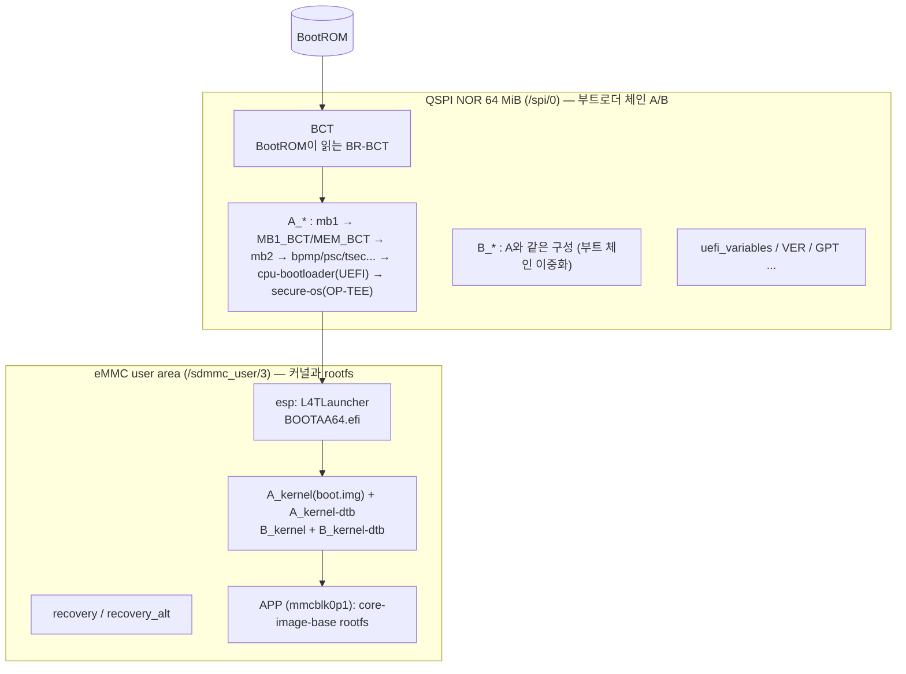

---
title:
source:
author:
published:
created: 2025-09-07
description:
tags:
---
# D315AO eMMC 기본 부팅 확인 가이드 — 개발킷 MACHINE, Docker 22.04 빌드 → 24.04 호스트 플래시

이 문서는 [`../sdk-analysis/D315AO_CUSTOM_LAYER_NECESSITY.md`](../sdk-analysis/D315AO_CUSTOM_LAYER_NECESSITY.md)의 **권장 순서 1단계**를 실행하기 위한 가이드다.

> 1단계: 커스텀 레이어 없이 meta-tegra 개발킷 MACHINE(`p3737-0000-p3701-0005`)으로 이미지를 빌드해 D315AO의 **eMMC 부팅**을 확인한다.

명령마다 **왜 실행하는지**를 붙였다. 프롬프트 표기는 다음과 같다.

| 표기 | 실행 위치 |
|------|-----------|
| `host$` | Ubuntu 24.04 호스트 (`louis`) |
| `ctr$` | 기존 Ubuntu 22.04 컨테이너 `prj-aicamsys-medspa-js-22.04` (사용자 `dinsight`, uid 1000) |
| `d315#` | D315AO 보드의 시리얼 콘솔 (root) |

---

## 0. 범위와 전제

### 0.1 이 단계에서 확인하는 것 / 확인하지 않는 것

| 확인한다 | 확인하지 않는다 (이후 단계) |
|----------|-----------------------------|
| Docker 22.04 컨테이너에서 meta-tegra 이미지가 끝까지 빌드되는지 | D315AO 전용 pinmux/GPIO (2·3단계, 커스텀 레이어) |
| 빌드 결과를 24.04 호스트에서 D315AO에 플래시할 수 있는지 | NVMe 부팅 (3단계 이후) |
| D315AO가 eMMC rootfs로 부팅해 시리얼 콘솔에 로그인되는지 | 캐리어 기능(USB 포트 배치, 오디오, 디스플레이, CAN 등) |

**왜 개발킷 MACHINE으로 충분한가?**
`D315AO_CUSTOM_LAYER_NECESSITY.md` 분석 결과, D315AO BSP와 개발킷 MACHINE은 부팅 체인 설정이 같다.

- 같은 항목: 메모리 BCT, PMIC, BPMP DTB, 파티션 레이아웃, ODMDATA, padvoltage
- 다른 항목: MB1 pinmux/GPIO, 커널 DTB(USB/오디오/디스플레이/UART)

eMMC와 디버그 UART는 모듈 쪽 자원이라 부팅까지는 될 가능성이 높다. 다만 **실제 보드로 확인한 적은 없으므로**, 이 문서가 그 확인 절차다.

### 0.2 통과 기준

1. `bitbake core-image-base` 가 컨테이너에서 에러 없이 끝난다.
2. 호스트에서 `doflash.sh` 가 `Flashing completed`(또는 동등한 성공 메시지)로 끝난다.
3. D315AO가 재부팅되어 시리얼 콘솔에 `root` 로 로그인된다.
4. `findmnt /` 의 SOURCE가 **`/dev/mmcblk0p1`** 이다.
5. 재부팅 후에도 3·4가 같다.

### 0.3 이 문서를 쓰면서 실제로 확인한 것 (2026-11-17)

| 항목 | 결과 |
|------|------|
| 컨테이너 | `prj-aicamsys-medspa-js-22.04` 가 실행 중이다(이미지 `dinsight/prj-aicamsys-medspa-js-22.04:0.0.0`). Ubuntu 22.04.5, Python 3.10.12, uid/gid 1000(`dinsight`) |
| 경로 매핑 | 호스트 `/home/louis/work` → 컨테이너 **`/home/1000/work`** (같은 경로가 **아니다**). 1.3 참고 |
| 로케일 | 컨테이너 기본 `LANG` 이 **비어 있다**. `en_US.utf8` 로케일은 설치돼 있다 → 2.2에서 export |
| 빌드 패키지 | chrpath, diffstat, gawk, cpio, socat, makeinfo, lz4, zstd, python3-git/jinja2/pexpect/subunit 모두 있음 |
| user namespace | 컨테이너 안 `unshare -rn true` **성공** → BitBake의 태스크 네트워크 격리가 동작한다 |
| 기존 빌드 디렉터리 | `build-docker-agx-orin-emmc` 가 이 컨테이너에서 이미 만들어져 있다. `bblayers.conf` 에 meta-tegra가 추가돼 있고, `local.conf` 는 아직 기본값(MACHINE 미설정)이다 |
| 파싱 검증 | 컨테이너에서 `MACHINE=p3737-0000-p3701-0005` 로 변수를 조회했다. `NATIVELSBSTRING=ubuntu-22.04`, `KERNEL_DEVICETREE=tegra234-p3737-0000+p3701-0005-nv.dtb`, `IMAGE_FSTYPES=tegraflash`, `TNSPEC_BOOTDEV=mmcblk0p1` |
| 레이어 커밋 | poky `scarthgap`, meta-tegra `scarthgap` `e7d217e2` (L4T R36.5.2) |
| 플래시 시 보드 확인 | meta-tegra `tegra-flash-helper.sh` 는 **모듈(CVM) EEPROM만** 읽는다(L329). 캐리어 EEPROM이 개발킷과 달라도 플래시가 막히지 않는다. 모듈 SKU는 검사한다(L383) |
| 호스트 도구 | `python3-yaml`, `dtc`, `cpp`, `sgdisk`, `udisksctl`, `minicom`, `screen`, `lsusb` 있음. `picocom` 없음 |
| ⚠️ **디스크** | `$YROOT` 가 있는 `/`(nvme0n1p3) 여유 **23 GB(98%)** — **빌드하기에 부족하다**. 1.2 참고 |

---

## 1. 사전 확인 (호스트)

### 1.1 작업 루트

```bash
host$ cd ~/work/project/jeisys-medical/aicamsys-medspa-js/sdk/AVerMedia/Yocto/scarthgap
host$ export YROOT=$PWD
host$ ls $YROOT
# build-docker-agx-orin-emmc  meta-tegra  poky  sdk-analysis  sdk-guide ...
```

**왜?** 이후 호스트 명령에서 작업 루트를 짧게 쓰기 위해서다. 새 터미널을 열 때마다 다시 설정한다.

### 1.2 디스크 확보 — 빌드 전 필수

```bash
host$ df -h $YROOT
host$ du -xsh ~/work/* 2>/dev/null | sort -h | tail -15
```

**왜?**
- 빌드 결과(`downloads/`, `sstate-cache/`, `build-*/tmp`)는 컨테이너가 아니라 **bind mount된 호스트 디스크**(`/`)에 쌓인다.
- meta-tegra `core-image-base` 한 벌의 예상 사용량은 다음과 같다(추정치, 실측 아님).

  | 항목 | 예상 크기 |
  |------|-----------|
  | `downloads` | 약 15 GB |
  | `sstate-cache` | 약 15~20 GB |
  | `tmp` (`rm_work` 사용 시) | 약 30~40 GB |
  | 합계 | 약 60~80 GB |

- 현재 여유는 23 GB뿐이다. 이 상태로 시작하면 `BB_DISKMON_DIRS` 가 빌드를 중간에 멈추거나(`STOPTASKS`/`HALT`), 디스크가 가득 차서 호스트 전체가 불안정해진다. **여유 100 GB 이상을 확보한 뒤 진행할 것을 권장한다.**
- `du` 로 큰 디렉터리를 찾는다. 무엇을 지울지는 직접 판단해야 한다(이 문서는 아무것도 지우지 않는다).

참고:
- `docker system df` 에 표시되는 회수 가능 공간(이미지 약 237 GB, 빌드 캐시 약 17 GB)은 **다른 디스크(nvme1n1, `/var/lib/docker`)** 에 있다. 지워도 `/` 의 여유는 늘지 않는다.
- 컨테이너는 `/home/louis/work` 만 마운트하고 있다. 다른 디스크를 쓰려면 컨테이너를 다시 만들어야 하므로 이 문서 범위 밖이다.
- `DL_DIR`/`SSTATE_DIR` 은 NFS에 둘 수 있다. `TMPDIR` 은 NFS에 둘 수 없다(BitBake sanity 검사에서 거부된다).

### 1.3 경로 매핑 이해

| 호스트 | 컨테이너 |
|--------|----------|
| `/home/louis/work/project/.../Yocto/scarthgap` | `/home/1000/work/project/.../Yocto/scarthgap` |

**왜 중요한가?**
- `build-docker-agx-orin-emmc/conf/bblayers.conf` 에는 **컨테이너 경로**(`/home/1000/...`)가 적혀 있다. 그래서 이 빌드 디렉터리의 `bitbake` 는 **반드시 이 컨테이너 안에서** 실행한다. 호스트에서 실행하면 레이어 경로를 찾지 못한다.
- 플래시는 호스트에서 한다. 플래시에 쓰는 `*.tegraflash.tar.gz` 는 그 자체로 완결된 패키지라 경로 차이의 영향을 받지 않는다. 호스트에서는 `/home/louis/...` 경로로 같은 파일을 읽으면 된다.

### 1.4 모듈 SKU 확인 (MACHINE 선택)

D315AO에 지금 AVerMedia BSP(Ubuntu)가 설치돼 있다면 보드에서 확인한다.

```bash
d315$ cat /proc/device-tree/model; echo
d315$ tr '\0' '\n' < /proc/device-tree/compatible
d315$ grep TNSPEC /etc/nv_boot_control.conf
d315$ free -g | head -2
```

> ⚠️ `cat /proc/device-tree/nvidia,dtsfilename` 은 쓰지 않는다. 이 속성은 R32/R35 DTB에만 있고, R36(JetPack 6) DTB에는 없다.
> 실제로 AVerMedia BSP의 `kernel/dtb/tegra234-p3737-0000+p3701-0005-nv-d315.dtb` 루트 노드에는 `compatible`, `interrupt-parent`, `#address-cells`, `#size-cells`, `model` 만 있다. 그래서 보드에서 실행하면 `No such file or directory` 가 난다(2026-11-18 보드에서 확인).

**왜?**
- meta-tegra 플래시 도구는 모듈 EEPROM의 SKU를 MACHINE과 비교하고, 다르면 `ERR: actual board SKU ... does not match expected board SKU` 로 멈춘다. 몇 시간 걸리는 빌드를 하기 전에 맞는 MACHINE을 정해 둔다.
- 각 명령으로 확인하는 내용은 다음과 같다.
  - `model` / `compatible` : 지금 실행 중인 DTB가 어느 SKU용인지 보여 준다. AVerMedia `flash.sh` 는 플래시할 때 모듈 EEPROM의 SKU를 읽어 해당 SKU의 DTB를 골라 기록한다(`D315AO_BOARD_CONF_ANALYSIS.md`). 그래서 이 값이 곧 모듈 SKU를 나타낸다. `compatible` 은 NUL 문자로 구분돼 있어서 `tr` 로 줄바꿈으로 바꿔 출력한다.
  - `nv_boot_control.conf` 의 `TNSPEC` : 플래시할 때 EEPROM에서 읽은 `BOARDID-FAB-BOARDSKU-...` 가 기록돼 있다. 두 번째 근거로 쓴다. 이 파일은 보드에서 직접 확인하지 않았으므로 없거나 형식이 다르면 건너뛴다.
  - `free -g` : 메모리 용량으로 한 번 더 교차 확인한다.
- 다음과 같이 고른다.

  | 확인 결과 | 모듈 | MACHINE |
  |-----------|------|---------|
  | `model`: `NVIDIA Jetson AGX Orin 64GB - AVerMedia D315` / `compatible`: `nvidia,p3701-0005` / `TNSPEC 3701-xxx-0005-…` / 메모리 약 62 GB | 64GB 모듈 | `p3737-0000-p3701-0005` (이 문서 기준) |
  | `compatible`: `nvidia,p3701-0004` / `TNSPEC 3701-xxx-0004-…` / 메모리 약 30 GB | 32GB 모듈 | `p3737-0000-p3701-0004` |

  64GB의 기대값은 BSP DTB 파일에서 직접 읽은 값이다.

  ```
  model      : NVIDIA Jetson AGX Orin 64GB - AVerMedia D315
  compatible : nvidia,p3737-0000+p3701-0005 / nvidia,p3701-0005 / nvidia,tegra234
  ```

- AVerMedia BSP의 flash 이미지에는 `p3701-0005-nv-d315`, `bpmp-3701-0005` 가 들어 있어서 0005일 가능성이 높다. 그래도 보드에서 직접 확인하는 것이 확실하다.
- 보드에 접근할 수 없으면 0005로 진행한다. SKU가 틀리면 7.2 플래시 단계에서 위 에러로 멈추므로 보드에 기록되기 전에 알 수 있다.

### 1.5 SKU란 무엇이고 출력을 어떻게 읽는가

#### 1.5.1 용어: 보드 ID, 보드 SKU, FAB, 칩 SKU

Jetson 모듈은 자기 정보를 **모듈 EEPROM(CVM EEPROM)** 에 저장해 둔다. 플래시 도구(`flash.sh`, meta-tegra `tegra-flash-helper.sh`)는 RCM으로 접속한 뒤 이 EEPROM을 덤프(`dump eeprom cvm`)하고, `chkbdinfo` 로 다음 값을 꺼낸다.

| 용어 | 예시 | 뜻 | 꺼내는 곳 (`tegra-flash-helper.sh`) |
|------|------|----|-------------------------------------|
| **보드 ID** (BOARDID) | `3701` | 모듈 **종류**. P3701 = Jetson AGX Orin 모듈. Orin NX/Nano 모듈은 `3767` | `chkbdinfo -i` (L359) |
| **FAB** (board version) | `300`, `500`, `TS4` | 모듈 PCB의 **하드웨어 개정판**. 같은 SKU라도 생산 시기에 따라 다르다 | `chkbdinfo -f` (L375) |
| **보드 SKU** (BOARDSKU) | `0005` | 같은 모듈 종류 안의 **제품 변형**. 메모리 용량, 산업용 여부 등이 SKU로 구분된다 | `chkbdinfo -k` (L381) |
| 보드 REV (BOARDREV) | `K.0` 등 | 같은 FAB 안의 세부 리비전 | `chkbdinfo -r` (L391) |
| **칩 SKU** (CHIP_SKU) | `00:00:00:D0` | **SoC 자체**의 퓨즈 SKU. 보드 SKU와 다른 값이다. BPMP 펌웨어 파일을 고르는 데 쓴다 | 퓨즈 읽기 → `chkbdinfo -C` (L338) |

이 문서에서 "SKU"라고만 쓰면 **보드 SKU**(4자리)를 뜻한다.

#### 1.5.2 AGX Orin(P3701) 보드 SKU 목록

아래 표의 근거는 meta-tegra machine conf의 `#@NAME`, L4T `p3701.conf.common` 의 주석, `tegra-flash-helper.sh` 의 분기다.

| 보드 SKU | 제품 | meta-tegra MACHINE | 근거 |
|----------|------|--------------------|------|
| `0000` | AGX Orin 개발자 키트 모듈 (초기 devkit) | `jetson-agx-orin-devkit` | `jetson-agx-orin-devkit.conf`: "P3701-0000 module in P3737-0000 carrier" (용량 표기 없음) |
| `0004` | **AGX Orin 32GB** | `p3737-0000-p3701-0004` | `p3737-0000-p3701-0004.conf`: "Jetson AGX Orin 32GB" |
| `0005` | **AGX Orin 64GB** | `p3737-0000-p3701-0005` | `p3737-0000-p3701-0005.conf`: "Jetson AGX Orin 64GB", `p3701.conf.common` L103 "p3701-0005 (64GB)" |
| `0008` | AGX Orin **Industrial** 64GB | `jetson-agx-orin-devkit-industrial` | `jetson-agx-orin-devkit-industrial.conf`: "AGX Orin Industrial 64GB (P3701-0008)" |
| `0001`, `0002` | 코드에만 나온다. 제품 설명은 소스에 없다 | — | `tegra-flash-helper.sh` L468/L477 |

D315AO 제품군(D315AO, D315AOB, D315AOP)은 사용자 매뉴얼상 32GB/64GB 모듈 구성이 있다. 그래서 **0004 또는 0005** 중 하나일 가능성이 높다.

#### 1.5.3 SKU가 왜 중요한가 — SKU에 따라 바뀌는 플래시 파일

SKU는 단순한 이름표가 아니다. 플래시 도구는 SKU에 따라 **부팅 초기에 쓰는 설정 파일**을 바꿔 끼운다(`tegra-flash-helper.sh` L455-482, `p3701.conf.common` `process_board_version()`).

| SKU에 따라 바뀌는 것 | 0004 (32GB) | 0005 (64GB) | 잘못되면 |
|----------------------|-------------|-------------|----------|
| 메모리 BCT (`EMMC_BCT`, `WB0SDRAM_BCT`) | 기본값 `p3701-0000-sdram` | **`p3701-0005-sdram`** | DRAM 용량·타이밍이 틀려 MB1 단계에서 부팅하지 못한다 |
| BPMP DTB (`BPFDTB_FILE`) | `bpmp-3701-0004-...` | `bpmp-3701-0005-...` | 클럭·전원 관리 설정이 틀린다 |
| PMIC 설정 | `pmic-p3701-0005` (0004/0005 공용) | `pmic-p3701-0005` | — |
| 커널 DTB | `...p3701-0004-nv.dtb` | `...p3701-0005-nv.dtb` | 메모리 영역, 모듈 쪽 장치 정의가 다르다 |
| 오래된 FAB용 pinmux 교체 | 적용될 수 있음 | **적용 안 됨**(L462 `!= "0005"`) | — |

메모리 BCT가 맞지 않으면 보드가 아예 부팅하지 않는다. 그래서 meta-tegra는 MACHINE의 `TEGRA_BOARDSKU` 와 EEPROM 값이 다르면 기록 전에 멈춘다(L383). 1.4에서 SKU를 미리 확인하는 이유가 이것이다.

칩 SKU는 BPMP 펌웨어 파일을 고르는 데 쓴다. `D0`/`D2` → `TE990M-A1`, `90` → `TE992M-A1`, `97`/`9E` → `TA990SA-A1` (L438-453). MACHINE 선택과는 상관없다.

#### 1.5.4 1.4 출력 읽는 법

**`compatible`** (예: `nvidia,p3737-0000+p3701-0005`)

```
nvidia,p3737-0000 + p3701-0005
       └── 캐리어 ──┘  └─ 모듈 ─┘
       P3737 SKU0000   P3701(AGX Orin) SKU 0005(64GB)
```

- `+` 앞은 캐리어 보드, 뒤는 모듈이다. meta-tegra MACHINE 이름 `p3737-0000-p3701-0005` 도 같은 규칙이다(캐리어-SKU-모듈-SKU).
- ⚠️ D315AO에서도 캐리어가 `p3737-0000`(NVIDIA 개발킷 캐리어)으로 나온다. AVerMedia가 개발킷 DTS를 바탕으로 D315 DTB를 만들고 `compatible` 을 바꾸지 않았기 때문이다(BSP DTB에서 확인). **캐리어 판단에는 쓰지 말고, 모듈 SKU(`p3701-XXXX`)만 읽는다.** 캐리어가 D315인지는 `model` 문자열(`... - AVerMedia D315`)로 확인한다.

**`model`** (예: `NVIDIA Jetson AGX Orin 64GB - AVerMedia D315`)

- 사람이 읽기 위한 문자열이다. 용량(`64GB`)과 캐리어(`AVerMedia D315`)가 들어 있다.
- 플래시 때 고른 DTB에서 오므로 SKU와 일치한다. 다만 DTB 작성자가 임의로 쓴 문자열이므로, 판단 근거는 `compatible` 을 우선한다.

**`TNSPEC`** (`/etc/nv_boot_control.conf`)

- 형식은 L4T `flash.sh` L2791-2792 주석 기준으로 `BOARDID-FAB-BOARDSKU-BOARDREV-NV_PRODUCTION-CHIP_REV-BOARD_NAME-...` 이다.
- 플래시할 때 EEPROM에서 읽은 값 그대로라 **가장 직접적인 근거**다. 세 번째 필드가 보드 SKU다.

  ```
  3701 - 500 - 0005 - K.0 - 1 - 1 - jetson-agx-orin-d315ao - ...
  │      │     │      │     │   │   └ BOARD_NAME (플래시 때 쓴 board conf 이름)
  │      │     │      │     │   └ CHIP_REV
  │      │     │      │     └ NV_PRODUCTION (fuse level)
  │      │     │      └ BOARDREV
  │      │     └ BOARDSKU  ← MACHINE 선택 기준
  │      └ FAB
  └ BOARDID (3701 = AGX Orin)
  ```

  FAB/REV/BOARD_NAME 값은 예시다. 실제 값은 보드마다 다르다.
- 이 TNSPEC은 OTA 업데이트 페이로드(BUP)가 "이 보드에 맞는 파일"을 고를 때도 쓴다. meta-tegra도 같은 형식으로 만든다(`tegra-flash-helper.sh` L785, `BOARD_NAME` 자리에 `MACHINE`).

**`free -g`**

- 커널이 예약 영역을 빼고 보여 주므로 64GB 모듈은 약 61~62, 32GB 모듈은 약 29~30으로 나온다. 다른 값과 맞는지 보는 보조 확인용이다.

**판정**: `compatible` 의 `p3701-XXXX` 와 `TNSPEC` 세 번째 필드가 같으면 그 값이 보드 SKU다. 그 SKU에 맞는 MACHINE을 1.5.2 표에서 고른다.

---

## 2. 컨테이너 진입과 셸 환경

### 2.1 호스트 tmux 안에서 컨테이너 셸 열기

```bash
host$ tmux new -s yocto-d315ao
host$ docker ps --filter name=prj-aicamsys-medspa-js-22.04 --format '{{.Names}} {{.Status}}'
host$ docker start prj-aicamsys-medspa-js-22.04      # Status가 Exited일 때만
host$ docker exec -it prj-aicamsys-medspa-js-22.04 bash
```

**왜?**
- `tmux` : 빌드는 몇 시간 걸린다. `docker exec` 로 띄운 셸은 호스트 터미널이 닫히면 함께 종료되고, 그 아래의 bitbake도 같이 끊긴다. 호스트 tmux 안에서 실행하면 터미널을 닫아도 빌드가 유지된다. 다시 붙을 때는 `tmux attach -t yocto-d315ao` 를 쓴다.
- `docker ps` / `start` : 이 컨테이너는 `--rm` 없이 상주하는 개발 컨테이너다. 호스트를 재부팅했다면 멈춰 있을 수 있다.
- `docker exec` : 새 컨테이너를 만들지 않고 기존 컨테이너에 셸을 하나 더 연다. 컨테이너 기본 사용자가 `1000:1000` 이라 root가 아니다. BitBake는 root로 실행하면 거부하므로 이 상태가 맞다.

### 2.2 로케일과 작업 루트

```bash
ctr$ export LANG=en_US.UTF-8 LC_ALL=en_US.UTF-8
ctr$ cd /home/1000/work/project/jeisys-medical/aicamsys-medspa-js/sdk/AVerMedia/Yocto/scarthgap
ctr$ export YROOT=$PWD
ctr$ id -u; df -h $YROOT | tail -1
```

**왜?**
- `LANG`/`LC_ALL` : 이 컨테이너는 `LANG` 이 비어 있다(0.3). BitBake는 UTF-8 로케일이 아니면 sanity 검사에서 멈춘다(`Please use a locale setting which supports UTF-8`). **셸을 새로 열 때마다** 실행한다.
- `cd` : 컨테이너 쪽 경로(`/home/1000/...`)를 쓴다(1.3).
- `id -u` 는 `1000` 이어야 한다. 그래야 호스트에서 결과 파일의 소유자가 `louis` 가 된다.
- `df` 로 1.2에서 확보한 공간이 컨테이너 안에서도 보이는지 확인한다(같은 디스크다).

---

## 3. 빌드 설정 (컨테이너)

### 3.1 레이어 버전 기록

```bash
ctr$ git -C poky       log -1 --oneline; git -C poky       branch --show-current
ctr$ git -C meta-tegra log -1 --oneline; git -C meta-tegra branch --show-current
```

**왜?** 나중에 "어떤 BSP 버전으로 부팅을 확인했는가"를 기록하기 위해서다. 기대값: poky `scarthgap`, meta-tegra `scarthgap` `e7d217e2`.
meta-tegra 커밋에 따라 L4T 버전(현재 R36.5.2)이 달라진다.

### 3.2 빌드 환경 초기화

```bash
ctr$ source poky/oe-init-build-env build-docker-agx-orin-emmc
ctr$ bitbake-layers show-layers
```

**왜?**
- `source oe-init-build-env <dir>` : 현재 셸에 `bitbake` PATH와 `BUILDDIR` 를 설정하고 빌드 디렉터리로 `cd` 한다. 이미 있는 `conf/` 는 덮어쓰지 않는다. `source` 로 실행해야 셸에 반영된다.
- 기존 디렉터리 `build-docker-agx-orin-emmc` 를 그대로 쓴다. 이 컨테이너에서 만들었고 meta-tegra가 이미 추가돼 있기 때문이다(0.3).
- `show-layers` 에 `core`, `yocto`, `yoctobsp`, `tegra` 4개가 보여야 한다. `tegra` 가 없으면 다음을 실행한다.
  ```bash
  ctr$ bitbake-layers add-layer $YROOT/meta-tegra
  ```

### 3.3 `conf/local.conf` 설정 추가

먼저 이전에 추가한 블록이 없는지 확인한다(두 번 추가하면 뒤 값이 이긴다).

```bash
ctr$ grep -n 'D315AO step1' conf/local.conf || echo "not yet"
```

`not yet` 이 나오면 아래 블록을 추가한다.

```bash
ctr$ cat >> conf/local.conf <<'EOF'

# ===== [D315AO step1] devkit MACHINE, eMMC rootfs, Docker 22.04 build =====
MACHINE = "p3737-0000-p3701-0005"

DL_DIR     = "${TOPDIR}/../downloads"
SSTATE_DIR = "${TOPDIR}/../sstate-cache"

INIT_MANAGER = "systemd"

BB_NUMBER_THREADS = "12"
PARALLEL_MAKE     = "-j 12"

INHERIT += "rm_work"

IMAGE_INSTALL:append = " nv-tegra-release pciutils usbutils util-linux e2fsprogs gptfdisk tegra-tools i2c-tools"
EXTRA_IMAGE_FEATURES += "ssh-server-openssh"
EOF
```

**각 줄이 왜 필요한가**

| 설정 | 이유 |
|------|------|
| `MACHINE = "p3737-0000-p3701-0005"` | 개발킷 MACHINE. 1.4에서 32GB 모듈로 확인됐으면 `p3737-0000-p3701-0004` 로 바꾼다. `local.conf` 기본값이 `MACHINE ??= "qemux86-64"`(약한 기본값)이므로 여기서 `=` 로 지정하면 덮어쓴다. |
| `DL_DIR` / `SSTATE_DIR` | `${TOPDIR}/..` = `$YROOT`. 빌드 디렉터리를 지우거나 이후 커스텀 레이어 단계(2·3단계)용 빌드 디렉터리를 새로 만들어도 다운로드와 sstate를 재사용한다. **2단계 빌드 시간이 크게 줄어든다.** |
| `INIT_MANAGER = "systemd"` | poky 기본은 sysvinit이다. meta-tegra/L4T 서비스(nvstartup, nvpmodel 등)는 systemd 기준이다. |
| `BB_NUMBER_THREADS` / `PARALLEL_MAKE` = 12 | 이 PC는 32코어 / 31 GB RAM이지만 다른 컨테이너·서비스가 약 15 GB를 쓰고 있다. 남은 약 16 GB에서 C++ 컴파일·링크가 동시에 돌 때 OOM을 피하려고 12로 제한한다. 여유가 생기면 16으로 올려도 된다. |
| `INHERIT += "rm_work"` | 레시피 빌드가 끝나면 작업 디렉터리를 지운다. 디스크가 부족한 이 환경에서는 사실상 필수다(1.2). |
| `IMAGE_INSTALL:append` | 부팅 확인과 2단계(차이 기록)에 쓸 도구들이다. `nv-tegra-release`(`/etc/nv_tegra_release`), `lspci`, `lsusb`, `lsblk`/`findmnt`, `sgdisk`, `tegrastats`, `i2cdetect`. **앞의 공백이 반드시 필요하다**(`:append` 는 공백을 넣어 주지 않는다). |
| `ssh-server-openssh` | 이더넷이 잡히면 SSH로도 접속할 수 있게 한다. poky 기본 `debug-tweaks` 때문에 root에 암호가 없다(**개발용만**). |

### 3.4 설정 확인 (빌드 전)

```bash
ctr$ bitbake-getvar --value MACHINE
ctr$ bitbake-getvar --value NATIVELSBSTRING
ctr$ bitbake-getvar --value KERNEL_DEVICETREE
ctr$ bitbake-getvar -r core-image-base --value TNSPEC_BOOTDEV
```

**왜?** `local.conf` 오타나 중복을 빌드 전에 잡기 위해서다. 0.3에서 확인한 기대값은 다음과 같다.

| 변수 | 기대값 | 의미 |
|------|--------|------|
| `MACHINE` | `p3737-0000-p3701-0005` | 3.3이 반영됨 |
| `NATIVELSBSTRING` | `ubuntu-22.04` | 22.04 컨테이너에서 빌드 중. native sstate가 이 이름으로 저장된다 |
| `KERNEL_DEVICETREE` | `tegra234-p3737-0000+p3701-0005-nv.dtb` | **개발킷 DTB**. D315 DTB가 아니라는 점을 기억해 둔다(8.3) |
| `TNSPEC_BOOTDEV` | `mmcblk0p1` | rootfs가 **eMMC** 로 설정됨 ← 이 단계의 핵심 |

---

## 4. 다운로드 → 빌드 (컨테이너)

### 4.1 다운로드만 먼저

```bash
ctr$ time bitbake core-image-base --runall=fetch
```

**왜?**
- 컴파일 없이 소스와 바이너리만 먼저 받는다. NVIDIA 서버의 L4T 패키지, GitHub의 커널·edk2·OP-TEE 소스를 받다가 생기는 네트워크 오류를 빌드 중간이 아니라 여기서 걸러낸다.
- 끝나면 `df -h $YROOT` 로 디스크를 다시 본다. 이 시점에 `downloads/` 가 약 15 GB 늘어난다. 남은 여유가 50 GB보다 작으면 빌드를 시작하지 말고 1.2로 돌아간다.

### 4.2 이미지 빌드

```bash
ctr$ time bitbake core-image-base
```

**왜?**
- 크로스 툴체인 → 커널 + NVIDIA OOT 모듈 → UEFI(edk2) → OP-TEE → rootfs → `do_image_tegraflash`(플래시 패키지 생성) 순서로 실행된다. 첫 빌드는 1.5~3시간 걸린다(추정).
- 중간에 끊겨도 같은 명령을 다시 실행하면 이어서 진행한다(끝난 태스크는 sstate에서 가져온다).
- 실패하면 마지막에 출력된 `ERROR: <recipe> do_<task>` 의 `log.do_<task>` 경로를 열어 원인을 확인한다(9장).

### 4.3 산출물 확인

```bash
ctr$ ls -lh tmp/deploy/images/p3737-0000-p3701-0005/ | grep -E 'tegraflash|\.dtb$'
```

**왜?**
- 플래시에 쓸 파일은 `core-image-base-p3737-0000-p3701-0005.rootfs.tegraflash.tar.gz` 하나다. 이 이름은 심볼릭 링크이고, 실제 파일 이름에는 타임스탬프가 붙는다.
- `.dtb` 목록에서 `tegra234-p3737-0000+p3701-0005-nv.dtb` 를 확인한다. 이번 이미지에 들어간 커널 DTB이며, 개발킷용이다.

이후 단계는 전부 호스트에서 한다. 컨테이너 셸은 `exit` 로 닫아도 된다. 컨테이너 자체는 계속 실행 상태로 둔다.

---

## 5. 호스트 플래시 준비 (1회)

```bash
host$ sudo apt install -y picocom
host$ sudo usermod -aG plugdev,dialout $USER
host$ cat <<'EOF' | sudo tee /etc/udev/rules.d/70-jetson-recovery.rules
SUBSYSTEM=="usb", ATTRS{idVendor}=="0955", MODE="0664", GROUP="plugdev"
EOF
host$ sudo udevadm control --reload-rules && sudo udevadm trigger
host$ cpp --version | head -1
host$ python3 -c 'import yaml; print("pyyaml", yaml.__version__)'
```

**왜?**
- 호스트는 빌드를 하지 않는다. 그래서 Yocto 빌드 패키지는 필요 없고, 플래시 패키지 안의 스크립트가 부르는 도구만 있으면 된다. `dtc`, `sgdisk`, `udisksctl`, `python3-yaml` 은 이미 있다(0.3).
- `picocom` : D315AO 디버그 UART용 시리얼 콘솔이다. 지금은 없다. 이미 설치된 `minicom` 이나 `screen` 을 써도 된다.
- `plugdev` + udev 규칙 : 리커버리 모드 Jetson(USB vendor `0955`)에 `sudo` 없이 접근하기 위해서다.
- `dialout` : `/dev/ttyUSB*` 시리얼 장치에 접근하기 위해서다.
- 그룹 변경은 **다시 로그인해야** 적용된다. 건너뛰면 플래시와 시리얼 명령에 `sudo` 를 붙인다.
- `cpp` : BCT `.dts` 전처리는 GNU cpp여야 한다. 출력이 `cpp (Ubuntu 13.x…)` 형태면 된다.
- eMMC 플래시(`doflash.sh`)는 USB 대용량 저장장치를 쓰지 않는다. 그래서 GNOME 자동마운트 해제나 `disk` 그룹은 이 단계에서는 필요 없다. NVMe 단계에서 다시 다룬다.

---

## 6. D315AO 연결

### 6.1 커넥터 (출처: `AVerMedia/D315AO/user_manual/AVerMedia_UM_D315 V1.8` 2.8 / 2.24 / 2.25 / 2.26장, 3.0장)

| 용도 | D315AO 위치 | 호스트 쪽 | 비고 |
|------|-------------|-----------|------|
| 플래시(리커버리) | **J8** USB 2.0 Micro-B ("BSP Installation as recovery mode") | 호스트 USB 포트에 **직결**(허브 금지) | 데이터 전송이 되는 고품질 케이블을 쓴다 |
| 시리얼 콘솔 | **JP8** Debug port, 1×4핀 2.54 mm: 1 = +3.3V, 2 = RX, 3 = TX, 4 = GND | **3.3V USB-TTL 변환기**(FTDI/CP2102 등) → `/dev/ttyUSB0` | 개발킷처럼 USB가 내장된 디버그 포트가 아니다 |
| 전원 버튼 | **BSW1** | — | |
| 리커버리 버튼 | **BSW3** | — | |
| 전원 모드 | **SW1-1** DIP: OFF = Auto Power, ON = Button Power | — | Auto Power면 DC를 연결하는 순간 켜진다 |

JP8 배선은 다음과 같다. **+3.3V(1번 핀)은 연결하지 않는다.**

| D315AO JP8 | USB-TTL 변환기 |
|------------|----------------|
| 2 RX | TX |
| 3 TX | RX |
| 4 GND | GND |

**왜?**
- 개발킷 MACHINE 이미지는 커널 DTB가 개발킷용이다. 그래서 D315AO의 HDMI/DP 출력이나 USB 키보드가 동작한다는 보장이 없다. 디스플레이 설정 데이터(DCB)와 USB 포트 매핑이 다르기 때문이다(`D315AO_CUSTOM_LAYER_NECESSITY.md`). **부팅 성공 여부를 확실히 볼 수 있는 곳은 시리얼 콘솔뿐이다.**
- RX/TX는 교차 연결한다. +3.3V를 연결하지 않는 이유는 변환기와 보드 전원이 서로 부딪히는 것을 피하기 위해서다.
- 부트로더(MB1/MB2/UEFI) 로그는 TCU(`ttyTCU0`, 115200 8N1)로 나온다. JP8이 이 TCU 포트일 것으로 보지만 **D315AO 회로도로 확인하지는 않았다.** 아무 출력이 없으면 9장을 참고한다.

### 6.2 첫 부팅 전 하드웨어 상태

- M.2 SSD, mPCIe/LTE, 카메라·SerDes 보드, CAN 배선, 40핀 헤더 장치는 **분리한 상태**로 진행할 것을 권장한다.
- 이더넷 케이블과 JP8 시리얼 연결만 남긴다.

**왜?** 개발킷 pinmux는 D315가 부팅 초기에 High/Low로 구동하는 GPIO 핀 10여 개(AG1, E0, E1, A6, K0, K1, X5, EE1 등)를 다르게 둔다(`D315AO_CUSTOM_LAYER_NECESSITY.md`). 이 핀들의 연결처는 회로도가 없어 모른다. 그래서 이 단계는 **모듈 자원(eMMC, UART)만으로 부팅되는지**를 보는 데 집중하고, 주변 장치는 이후 단계에서 붙인다.

### 6.3 시리얼 콘솔 열기

```bash
host$ ls /dev/ttyUSB*
host$ picocom -b 115200 /dev/ttyUSB0 --logfile $YROOT/flash/d315ao-step1-console.log
# 종료: Ctrl-A Ctrl-X
```

**왜?** 플래시 직후 첫 부팅 로그를 처음부터 받기 위해 **플래시 전에** 열어 둔다. `--logfile` 로 남긴 로그는 2단계(차이 기록)의 기준 자료가 된다.
`$YROOT/flash` 가 없으면 먼저 `mkdir -p $YROOT/flash` 를 실행한다.

### 6.4 리커버리 모드 진입

1. DC 전원을 분리한다.
2. **BSW3(Recovery)** 를 누른 상태로 DC 전원을 연결한다. SW1-1이 Button Power(ON)면, 전원을 연결한 뒤 BSW3를 누른 채 **BSW1(Power)** 을 누른다.
3. 2초 후 손을 뗀다.

```bash
host$ lsusb -d 0955:
# 예) Bus 001 Device 012: ID 0955:7023 NVIDIA Corp. APX
host$ sudo dmesg | tail -5      # Product: APX / Manufacturer: NVIDIA Corp
```

**왜?** 리커버리(RCM) 모드는 BootROM이 USB로 부트로더를 받으려고 기다리는 상태다. `0955:xxxx` 장치가 보여야 플래시 도구가 보드와 통신할 수 있다(사용자 매뉴얼 3.1장의 확인 방법과 같다). 이 상태에서는 시리얼 콘솔에 아무것도 나오지 않는 것이 정상이다.

---

## 7. eMMC 플래시 (호스트)

> ⚠️ 이 플래시는 D315AO의 **QSPI 부트로더와 eMMC 전체를 덮어쓴다.** 현재 설치된 AVerMedia BSP(Ubuntu)와 그 안의 데이터는 지워진다.
> 필요한 파일은 먼저 백업한다. 원래 상태로 되돌리는 방법은 10장에 있다.

### 7.1 패키지 풀기

```bash
host$ M=p3737-0000-p3701-0005          # 3.3에서 쓴 MACHINE (32GB 모듈이면 p3737-0000-p3701-0004)
host$ D=$YROOT/build-docker-agx-orin-emmc/tmp/deploy/images/$M
host$ ls -lh $D/core-image-base-$M.rootfs.tegraflash.tar.gz
host$ mkdir -p $YROOT/flash/d315ao-step1-emmc && cd $YROOT/flash/d315ao-step1-emmc
host$ ls -A
host$ tar -xf $D/core-image-base-$M.rootfs.tegraflash.tar.gz
host$ ls doflash.sh tegra-flash-helper.sh tegrarcm_v2 tegraflash.py
```

**왜?**
- 호스트 경로(`/home/louis/...`)로 컨테이너가 만든 파일을 그대로 읽는다(1.3). 복사할 필요가 없다.
- `ls -A` 결과가 **비어 있어야** 한다. 이전 시도에서 생긴 `signed/` 등과 섞이면 다른 버전의 바이너리가 기록될 수 있다. 비어 있지 않으면 내용을 확인한 뒤 디렉터리를 비우거나 새 디렉터리를 쓴다.
- `tar` 는 CLI로 푼다(GUI 압축 도구는 sparse 파일을 깨뜨린다는 보고가 있다).
- 마지막 `ls` 로 플래시 도구가 패키지 안에 들어 있는지 확인한다. 호스트에 Yocto가 없어도 플래시할 수 있는 이유가 이것이다.

### 7.2 사전 점검 → 플래시

```bash
host$ head -2 doflash.sh | tail -1 | cut -c1-80
host$ file tegrarcm_v2 tegradevflash_v2 | cut -c1-80
host$ ./tegrarcm_v2 2>&1 | grep -m1 '^Usage: tegrarcm_v2' || echo "tegrarcm_v2 NG"
host$ /usr/bin/python3 tegraflash.py --help 2>&1 | grep -m1 'Usage: tegraflash' || echo "tegraflash.py NG"
host$ lsusb -d 0955:
host$ sudo ./doflash.sh 2>&1 | tee doflash.log
```

**왜?**
- `head … doflash.sh` : 첫 단어가 `MACHINE=<3.3에서 쓴 MACHINE>` 인지 확인한다. 다른 MACHINE으로 만든 패키지를 풀었는지 여기서 잡는다.
- 나머지 세 줄은 빌드 환경(22.04)과 다른 호스트(24.04)에서 플래시 도구가 실행되는지 **보드를 건드리기 전에** 확인한다.
  - `file` : 둘 다 `ELF 32-bit LSB executable, Intel 80386, ... statically linked` 이어야 한다. NVIDIA가 제공한 32비트 정적 바이너리라서 호스트 라이브러리와 상관없이 실행된다.
  - `tegrarcm_v2` 와 `tegraflash.py` 는 **`--help` 옵션이 없다.** 인자가 없거나 잘못되면 사용법(`Usage: …`)을 출력하고 0이 아닌 코드(`tegrarcm_v2` = 4, `tegraflash.py` = 1)로 끝나는 것이 **정상**이다. 그래서 종료 코드가 아니라 **`Usage:` 줄이 출력되는지**로 판단한다. 두 줄 모두 `Usage:` 줄이 나와야 하고 `NG` 가 나오면 안 된다. `tegraflash.py` 는 모듈 import가 끝난 뒤에 사용법을 출력하므로, 이 줄이 나오면 PyYAML 등 Python 의존성도 문제가 없다는 뜻이다.
  - `/usr/bin/python3` 로 실행하는 이유: `sudo ./doflash.sh` 는 sudo의 `secure_path` 때문에 conda/mise가 아닌 **시스템 Python(3.12)** 을 쓴다. 점검도 같은 인터프리터로 해야 의미가 있다.
  - 이 점검 이력은 `../sdk-debugging/ISSUE-001_tegrarcm_v2_help_exit4.md` 에 있다.
- `lsusb` : 6.4 이후 시간이 지나 리커버리 모드가 풀리지 않았는지 다시 확인한다.
- `doflash.sh` 가 하는 일은 다음 순서다(10~20분).
  1. `tegra-flash-helper.sh` 를 호출한다.
  2. RCM으로 보드에 접속해 **모듈 EEPROM**에서 BOARDID(3701)와 SKU를 읽고 MACHINE과 비교한다.
  3. BCT와 DTB를 고르고 서명한다.
  4. **QSPI(부트로더)와 eMMC(GPT, esp, APP=rootfs …)** 에 기록하고 재부팅한다. 파티션별 이미지는 7.3 참고.
- 캐리어 EEPROM은 읽지 않는다(0.3). 그래서 개발킷이 아닌 D315AO 캐리어에서도 이 확인 단계는 통과해야 정상이다.
- `tee` : 실패했을 때 원인을 볼 수 있게 로그를 남긴다.
- `sudo` : 5장에서 그룹 설정을 하고 다시 로그인했다면 생략할 수 있다.

### 7.3 플래시되는 파티션과 이미지 (QSPI / eMMC)

이 절의 근거는 **2026-11-19 실제 플래시 결과**다(MACHINE `p3737-0000-p3701-0004`, 모듈 `BOARDID=3701 FAB=500 BOARDSKU=0004 REV=L.0`, 칩 SKU `0xD2`).

| 자료       | 위치                                         | 알 수 있는 것                                                                                                                  |
| -------- | ------------------------------------------ | ------------------------------------------------------------------------------------------------------------------------- |
| 파티션 레이아웃 | `$YROOT/flash/d315ao-step1-emmc/flash.xml` | `doflash.sh` 가 `flash.xml.in` 에서 만든 최종 레이아웃. 원본 템플릿은 meta-tegra `PARTITION_LAYOUT_TEMPLATE` = `flash_t234_qspi_sdmmc.xml` |
| 실제 기록 내역 | 같은 디렉터리의 `doflash.log`                     | `Writing partition <이름> with <파일>` 줄                                                                                      |
| 이미지 출처   | 패키지 파일과 빌드 산출물 / L4T tarball을 `cmp` 로 비교   | 각 파일을 어느 레시피가 만들었는지                                                                                                       |

SKU가 0005이면 파일 이름의 `0004` 가 `0005` 로 바뀐다. 예: `tegra234-bpmp-3701-0005-3737-0000.dtb`, `kernel_tegra234-p3737-0000+p3701-0005-nv.dtb`.

경로 표기는 다음과 같다.

| 표기 | 실제 경로 |
|------|-----------|
| `$PKG` | `$YROOT/flash/d315ao-step1-emmc` — 풀어 놓은 플래시 패키지 |
| `$DEPLOY` | `$YROOT/build-docker-agx-orin-emmc/tmp/deploy/images/$M` — 빌드 산출물 |
| `L4T:` | `$YROOT/downloads/Jetson_Linux_R36.5.2_aarch64.tbz2` 안의 경로 (`Linux_for_Tegra/...`) |

#### 7.3.1 전체 구조



부팅 순서는 다음과 같다.
1. BootROM이 QSPI의 **BCT** 를 읽는다.
2. MB1 → MB2 → UEFI(`cpu-bootloader`) 순으로 실행된다. 이것들이 **QSPI**에 있다.
3. UEFI가 eMMC의 **esp** 에 있는 L4TLauncher를 실행한다.
4. L4TLauncher가 **APP**(rootfs)의 `/boot/extlinux/extlinux.conf` 를 읽는다. 커널은 그 설정 또는 `A_kernel`(boot.img)에서 올린다.

그래서 이 플래시는 QSPI(부트로더)와 eMMC(커널, rootfs)를 **둘 다** 바꾼다. 10장에서 복원할 때 BSP 전체를 다시 플래시해야 하는 이유도 이것이다.

#### 7.3.2 QSPI (`<device type="spi" instance="0">`, 131072 섹터 × 512 B = 64 MiB)

`A_*` 와 `B_*` 는 같은 이미지를 담는다. 한쪽 부트 체인이 깨져도 다른 쪽으로 부팅하기 위한 이중화다. 아래 표는 A만 적었다.

QSPI는 **sparse flash** 로 기록된다(`doflash.log`: `Sparse flash qspi device instance 0`). 도구가 각 파티션을 먼저 읽어서 비교하고, 내용이 다를 때만 지우고 쓴다. "이번 기록" 열은 다음 뜻이다.

| 표시 | 뜻 |
|------|----|
| ✅ | 로그에 `Writing partition` 이 있다 |
| ⏭ | 읽기만 하고 쓰지 않았다. 기존(AVerMedia BSP) 내용과 같다고 판단한 것으로 본다 |
| — | 파일이 지정되지 않은 빈 파티션 |

| 파티션                                      | 크기                 | 기록 파일 (`$PKG`)                                | 원본 → 출처                                                                                                                                                                                                 | 역할                                                                                   | 이번 기록   |
| ---------------------------------------- | ------------------ | --------------------------------------------- | ------------------------------------------------------------------------------------------------------------------------------------------------------------------------------------------------------- | ------------------------------------------------------------------------------------ | ------- |
| `BCT`                                    | 1 MiB              | `br_bct_BR.bct` (플래시 때 생성)                    | `$PKG/tegra234-br-bct-p3701-0000.dts` ← `L4T: bootloader/generic/BCT/`                                                                                                                                  | BootROM용 BCT: 부트 미디어 파라미터, 서명 정보                                                     | ✅       |
| `A_mb1`                                  | 512 KiB            | `mb1_t234_prod.bin`                           | `L4T: bootloader/mb1_t234_prod.bin` (tegra-bootfiles)                                                                                                                                                   | 1단계 부트로더                                                                             | ✅       |
| `A_psc_bl1`                              | 256 KiB            | `psc_bl1_t234_prod.bin`                       | `L4T: bootloader/`                                                                                                                                                                                      | PSC(보안 코프로세서) 부트로더                                                                   | ⏭       |
| `A_MB1_BCT`                              | 128 KiB            | `mb1_cold_boot_bct_MB1.bct` (생성)              | **pinmux** `tegra234-mb1-bct-pinmux-p3701-0000-a04.dtsi`, **gpio** `…-gpioint-p3701-0000.dts`, **pmic** `…-pmic-p3701-0005.dts`, padvoltage, misc, device, prod, reset ← `L4T: bootloader/generic/BCT/` | MB1 설정. **D315AO 커스텀 레이어가 바꿀 대상이 여기다**(pinmux/GPIO)                                  | ✅       |
| `A_MEM_BCT`                              | 256 KiB            | `mem_coldboot.bct` (생성)                       | `tegra234-p3701-0000-sdram-l4t.dts` (0005면 `-0005-`) ← `L4T: bootloader/generic/BCT/`                                                                                                                   | DRAM 설정. SKU가 맞아야 하는 이유(1.5.3)                                                       | ✅       |
| `A_tsec-fw`                              | 1 MiB              | `tsec_t234.bin`                               | `L4T: bootloader/`                                                                                                                                                                                      | TSEC 보안 엔진 FW                                                                        | ⏭       |
| `A_nvdec`                                | 1 MiB              | `nvdec_t234_prod.fw`                          | `L4T: bootloader/`                                                                                                                                                                                      | NVDEC(비디오 디코더) FW                                                                    | ⏭       |
| `A_mb2`                                  | 512 KiB            | `mb2_t234.bin` + MB2-BCT (생성)                 | `mb2_t234.bin` ← `L4T: bootloader/`. MB2-BCT ← `tegra234-mb2-bct-misc-p3701-0000.dts`, `…-scr-…`                                                                                                        | 2단계 부트로더                                                                             | ✅       |
| `A_xusb-fw`                              | 256 KiB            | `xusb_t234_prod.bin`                          | `L4T: bootloader/`                                                                                                                                                                                      | USB 컨트롤러 FW                                                                          | ⏭       |
| `A_bpmp-fw`                              | 1.5 MiB            | `bpmp_t234-TE990M-A1_prod.bin`                | `L4T: bootloader/`. 칩 SKU `D0`/`D2` → `TE990M` (1.5.3)                                                                                                                                                  | BPMP(전원·클럭 관리) FW                                                                    | ⏭       |
| `A_bpmp-fw-dtb`                          | 4 MiB              | `tegra234-bpmp-3701-0004-3737-0000.dtb`       | `L4T: bootloader/generic/`. tegra-bootfiles가 설치할 때 `/serial` 노드를 제거할 수 있다(`TEGRA_BPMP_SERIAL_LOGGING`)                                                                                                  | BPMP 설정 DTB                                                                          | ⏭       |
| `A_psc-fw`                               | 768 KiB            | `pscfw_t234_prod.bin`                         | `L4T: bootloader/`                                                                                                                                                                                      | PSC FW                                                                               | ⏭       |
| `A_mts-mce`                              | 512 KiB            | `mce_flash_o10_cr_prod.bin`                   | `L4T: bootloader/`                                                                                                                                                                                      | CPU 마이크로코드/MCE                                                                       | ⏭       |
| `A_sc7`                                  | 192 KiB            | `sc7_t234_prod.bin`                           | `L4T: bootloader/`                                                                                                                                                                                      | SC7(서스펜드) 복귀 FW                                                                      | ✅       |
| `A_pscrf`                                | 192 KiB            | `psc_rf_t234_prod.bin`                        | `L4T: bootloader/`                                                                                                                                                                                      | PSC 복귀 FW                                                                            | ⏭       |
| `A_mb2rf`                                | 128 KiB            | `mb2rf_t234.bin`                              | `L4T: bootloader/`                                                                                                                                                                                      | MB2 복귀 FW                                                                            | ⏭       |
| `A_cpu-bootloader`                       | 3.5 MiB            | `uefi_t23x_general_with_dtb.bin` (생성)         | `uefi_t23x_general.bin` ← **edk2-firmware-tegra 소스 빌드** (`$DEPLOY/uefi_t23x_general.bin`, `cmp` 일치) + 커널 DTB(TBCDTB)                                                                                    | **UEFI**. DTB를 함께 담아 커널에 넘긴다                                                         | ✅       |
| `A_secure-os`                            | 4 MiB              | `tos-optee_t234.img`                          | **tos-optee 소스 빌드**(ATF + OP-TEE) `$DEPLOY/tos-$M.img` (`cmp` 일치). L4T tarball의 prebuilt는 쓰지 않는다                                                                                                        | TrustZone OS                                                                         | ✅       |
| `A_smm-fw`                               | 2 MiB              | —                                             | —                                                                                                                                                                                                       | 예약(StandaloneMM)                                                                     | —       |
| `A_eks`                                  | 256 KiB            | `eks.img`                                     | `L4T: bootloader/eks_t234.img` (tegra-eks-image)                                                                                                                                                        | 암호화 키 저장소(EKS). NVIDIA 기본 이미지 그대로                                                    | ⏭       |
| `A_dce-fw`                               | 5 MiB              | `display-t234-dce.bin` + 커널 DTB (생성)          | `L4T: bootloader/display-t234-dce.bin`                                                                                                                                                                  | 디스플레이 컨트롤러 FW. 커널 DTB를 같이 담는다                                                        | ✅       |
| `A_spe-fw`                               | 576 KiB            | `spe_t234.bin`                                | `L4T: bootloader/`                                                                                                                                                                                      | SPE(Always-on Cortex-R5) FW                                                          | ⏭       |
| `A_rce-fw`                               | 1 MiB              | `camera-rtcpu-t234-rce.img`                   | `L4T: bootloader/`                                                                                                                                                                                      | 카메라 RTCPU FW                                                                         | ⏭       |
| `A_adsp-fw`                              | 2 MiB              | `adsp-fw.bin`                                 | `L4T: bootloader/`                                                                                                                                                                                      | 오디오 DSP FW                                                                           | ✅       |
| `A_pva-fw`                               | 256 KiB            | `nvpva_020.fw`                                | `L4T: bootloader/`                                                                                                                                                                                      | PVA(비전 가속기) FW                                                                       | ⏭       |
| `A_reserved_on_boot`                     | 1088 KiB           | —                                             | —                                                                                                                                                                                                       | 예약                                                                                   | —       |
| `B_mb1` … `B_reserved_on_boot`           | (A와 동일)            | (A와 동일)                                       | (A와 동일)                                                                                                                                                                                                 | 부트 체인 B                                                                              | (A와 동일) |
| `uefi_variables` / `uefi_ftw`            | 256 / 512 KiB      | —                                             | —                                                                                                                                                                                                       | UEFI 변수 저장소 (부팅 중 UEFI가 사용)                                                          | —       |
| `worm`, `reserved`, `reserved_partition` | 192 / 192 / 64 KiB | —                                             | —                                                                                                                                                                                                       | 예약                                                                                   | —       |
| `BCT-boot-chain_backup`                  | 64 KiB             | `bct_backup.img` (생성)                         | —                                                                                                                                                                                                       | BCT 백업                                                                               | ✅       |
| `A_VER` / `B_VER`                        | 64 KiB             | `p3737-0000-p3701-0004_bootblob_ver.txt` (생성) | `tegra-flash-helper.sh`                                                                                                                                                                                 | 부트로더 버전: `# R36 , REVISION: 5.2`, `BOARDID=3701 BOARDSKU=0004 FAB=500`, 빌드 시각, CRC32 | ✅       |
| `secondary_gpt_backup` / `secondary_gpt` | 64 KiB / 나머지       | `gpt_*_3_0.bin` (생성)                          | —                                                                                                                                                                                                       | QSPI의 GPT                                                                            | ✅       |

- "(생성)"은 패키지에 완성된 파일이 없고 `tegra-flash-helper.sh` / `tegraflash.py` 가 **플래시할 때** 만든다는 뜻이다. BCT `.dts` 와 `flashvars` 를 조합해 만들고, 서명 헤더를 붙인 `*_sigheader.*.encrypt` 형태로 기록한다. 중간 파일은 `$PKG/temp/` 에 남는다.
- 모든 QSPI 이미지는 기록 전에 서명 헤더가 붙는다. 이 보드는 보안 퓨즈를 쓰지 않으므로 키 없이(`--key None`) SHA 해시만 들어간다.
- `L4T: bootloader/...` 파일은 **tegra-bootfiles** 레시피가 tarball에서 꺼내 sysroot의 `/usr/share/tegraflash` 에 설치하고, `image_types_tegra.bbclass` 가 패키지로 복사한 것이다. 빌드 중 sysroot는 `rm_work` 로 지워지므로 원본은 tarball에서 확인한다.
  ```bash
  host$ tar -tjf $YROOT/downloads/Jetson_Linux_R36.5.2_aarch64.tbz2 | grep -E 'bootloader/(mb1_t234_prod.bin|generic/BCT/tegra234-mb1-bct-pinmux-p3701-0000-a04.dtsi)$'
  ```

#### 7.3.3 eMMC (`<device type="sdmmc_user" instance="3">`)

eMMC는 sparse 비교 없이 파일이 지정된 파티션을 모두 기록한다. 순서대로 `mmcblk0p1`, `p2`, … 가 되는 것이 **아니다**. `flash.xml` 에서 `APP` 에 `id="1"`, `A_kernel` 에 `id="2"` 처럼 번호가 직접 지정돼 있어서 `APP` 이 `mmcblk0p1` 이 된다(`TNSPEC_BOOTDEV=mmcblk0p1`, 3.4).

| 파티션 | 크기 | 기록 파일 (`$PKG`) | 원본 → 출처 | 역할 |
|--------|------|--------------------|-------------|------|
| `master_boot_record` / `primary_gpt` | 512 B / 19.5 KiB | `mbr_1_3.bin`, `gpt_primary_1_3.bin` (생성) | — | 보호 MBR + GPT |
| `A_kernel` | 128 MiB | `boot.img` (48 MB) | `$DEPLOY/tegra-minimal-initramfs-$M.cboot` (`cmp` 일치). 커널 `Image`(linux-jammy-nvidia-tegra) + `tegra-minimal-initramfs` 를 mkbootimg로 묶은 것 | 커널 + initramfs |
| `A_kernel-dtb` | 768 KiB | `kernel_tegra234-p3737-0000+p3701-0004-nv.dtb` | `$DEPLOY/devicetree/tegra234-p3737-0000+p3701-0004-nv.dtb` (`cmp` 일치) ← **nvidia-kernel-oot-dtb**. 플래시 도구가 `kernel_` 접두어를 붙여 복사한다 | 커널 DTB. **개발킷 DTB**(D315 DTB 아님, 8.3) |
| `A_reserved_on_user` | 31.6 MiB | — | — | 예약 |
| `B_kernel` / `B_kernel-dtb` / `B_reserved_on_user` | A와 같음 | A와 같음 | A와 같음 | 커널 A/B |
| `recovery` / `recovery-dtb` | 80 MiB / 512 KiB | — (비어 있음) | — | 복구 커널(이번 이미지에서는 사용 안 함) |
| `esp` | 64 MiB | `esp.img` | `$DEPLOY/tegra-espimage-$M.esp` (`cmp` 일치). 안에 `BOOTAA64.efi` = **L4TLauncher**(edk2-firmware-tegra가 빌드)가 들어 있다(이미지 안에서 문자열 확인) | EFI 시스템 파티션. UEFI가 여기서 L4TLauncher를 실행한다 |
| `recovery_alt` / `recovery-dtb_alt` / `esp_alt` | 80 MiB / 512 KiB / 64 MiB | — | — | 이중화 예비 |
| `UDA` | 400 MiB | — | — | 사용자 데이터 영역(비어 있음) |
| `reserved` | 479.5 MiB | — | — | 예약 |
| **`APP`** | **28 GiB** (`ROOTFSPART_SIZE`) | `core-image-base.ext4.img` (sparse, 235 MB) | `$DEPLOY/core-image-base-$M.rootfs.ext4`(30 GB 원본) → `mksparse` 로 sparse 변환 | **rootfs** = `/dev/mmcblk0p1`. `/boot/extlinux/extlinux.conf` 와 커널도 여기 들어 있다 |
| `secondary_gpt` | 나머지 끝 | `gpt_secondary_1_3.bin` (생성) | — | 백업 GPT |

- `flash.xml` 의 eMMC `num_sectors="119537664"`(약 57 GiB)는 레이아웃 템플릿 값이다. 실제 eMMC 용량은 보드에서 `lsblk` 로 확인한다(8.2).
- `APP` 크기를 바꾸려면 `local.conf` 에 `ROOTFSPART_SIZE` 를 설정한다(meta-tegra 기본 `ROOTFSPART_SIZE_DEFAULT = 30064771072`, `agx-orin.inc`).

#### 7.3.4 커스텀 레이어 단계에서 바뀔 파티션

| 변경 | 바뀌는 파티션 | 원본 파일 |
|------|---------------|-----------|
| D315 pinmux/GPIO (3단계 최소 레이어) | QSPI `A/B_MB1_BCT` | `TEGRA_FLASHVAR_PINMUX_CONFIG`, `TEGRA_FLASHVAR_GPIOINT_CONFIG` 가 가리키는 dtsi/dts |
| D315 커널 DTB (전체 레이어) | eMMC `A/B_kernel-dtb`, QSPI `A/B_cpu-bootloader`(UEFI에 묶이는 DTB), `A/B_dce-fw` | `KERNEL_DEVICETREE` |

이 표가 나중에 "D315AO 이미지를 올렸는데 무엇이 바뀌었나"를 확인하는 기준이 된다. `doflash.log` 의 `Writing partition` 줄을 이번 기록과 비교하면 된다.

---

## 8. 부팅 검증 (D315AO 시리얼 콘솔)

### 8.1 콘솔에서 볼 것

플래시가 끝나면 보드가 자동으로 재부팅된다. 6.3에서 연 콘솔에 다음 순서로 로그가 나와야 한다.

1. MB1/MB2 로그
2. UEFI 로그(`Jetson UEFI firmware`)
3. 커널 로그
4. `<MACHINE> login:` (예: `p3737-0000-p3701-0005 login:`)

`root` 로 로그인한다(암호 없음).

### 8.2 통과 기준 확인

| 명령                                              | 기대 결과 / 의미                                                                                                  |
| ----------------------------------------------- | ----------------------------------------------------------------------------------------------------------- |
| `d315# cat /etc/nv_tegra_release`               | `# R36 (release), REVISION: 5.2` — meta-tegra 기준 BSP가 올라갔다                                                  |
| `d315# uname -a`                                | 빌드 시각이 4.2의 빌드 시각과 맞는다(다른 이미지가 올라가지 않았다)                                                                    |
| `d315# findmnt /`                               | SOURCE **`/dev/mmcblk0p1`** ← **이 단계의 핵심**                                                                  |
| `d315# lsblk -o NAME,SIZE,PARTLABEL,MOUNTPOINT` | `mmcblk0` 에 `APP`(약 28 GiB, `mmcblk0p1`), `esp`, `A_kernel` 등 7.3.3의 파티션이 있다. `mmcblk0` 전체 크기가 실제 eMMC 용량이다 |
| `d315# systemctl --failed`                      | 실패한 서비스 목록. 0개가 이상적이지만 8.3의 "예상 차이" 때문에 실패가 있을 수 있다. 목록을 기록해 둔다                                             |
| `d315# lsmod \| grep -E 'nvgpu\|nvmap'`         | GPU 핵심 모듈이 로드됐다                                                                                             |
| `d315# reboot` 후 다시 로그인, `findmnt /`            | 재부팅해도 eMMC로 부팅된다                                                                                            |

**왜 이 항목들인가?** 이 단계의 목표는 "D315AO에서 meta-tegra 이미지가 eMMC로 부팅된다"는 것 하나다. 나머지 주변장치 동작은 판정 기준이 아니다.

### 8.3 예상되는 차이 (실패가 아님)

개발킷 DTB와 개발킷 pinmux를 썼기 때문에 다음은 **정상적으로 예상되는 차이**다. 원인은 `D315AO_CUSTOM_LAYER_NECESSITY.md` 의 DTB 비교 결과에서 나온 것이다.

| 증상 | 원인 |
|------|------|
| `cat /proc/device-tree/model` 이 `NVIDIA Jetson AGX Orin Developer Kit` 로 나온다 | 개발킷 DTB를 썼다. D315 DTB의 model 문자열과 다르다 |
| Type-C 컨트롤러(`cypd4226`, i2c) probe 에러가 dmesg에 나온다 | D315에는 이 칩이 없는데 개발킷 DTB에는 있다 |
| 일부 USB 포트가 동작하지 않거나 USB3 장치가 USB2로 붙는다 | USB2/USB3 포트 짝 배정(companion)과 usb2-0 모드(otg/peripheral)가 다르다 |
| 오디오 코덱(`rt5640`) probe 에러, 사운드카드가 없다 | D315는 TLV320AIC3101 코덱을 쓴다 |
| HDMI/DP에 화면이 나오지 않는다 | 디스플레이 출력 구성 정보(DCB)가 다르다 |
| CAN, 40핀 일부 기능이 동작하지 않는다 | MB1 pinmux가 개발킷 기준이다 |

**모르는 것 — 관찰해서 기록할 것**
- 이더넷이 링크업되는지 (`ip -br link`). MGBE 노드는 두 DTB가 같지만, 실제로 어떤 포트가 연결돼 있는지는 확인하지 않았다.
- 6.2에서 말한 GPIO 핀들이 개발킷 설정에서 어떤 상태가 되는지.

### 8.4 2단계로 넘길 로그 남기기

```bash
d315# mkdir -p /root/step1 && cd /root/step1
d315# dmesg > dmesg.txt; lsusb -t > lsusb-t.txt; lspci -vv > lspci.txt 2>&1
d315# systemctl --failed > failed.txt; cat /sys/kernel/debug/gpio > gpio.txt 2>&1
d315# cat /proc/device-tree/model > model.txt; ip -br link > link.txt
```

이더넷이 연결됐다면 호스트로 가져온다. 안 되면 콘솔 로그(6.3 `--logfile`)에서 출력을 복사한다.

```bash
host$ scp -r root@<D315AO_IP>:/root/step1 $YROOT/flash/d315ao-step1-logs
```

**왜?** 권장 순서 2단계("위 차이가 실제로 어떻게 나타나는지 기록")의 입력 자료다. 특히 `gpio.txt` 는 3단계에서 D315 pinmux/GPIO를 넣은 이미지와 비교할 기준값이 된다.

---

## 9. 트러블슈팅

| 증상 | 원인 / 조치 |
|------|-------------|
| `Please use a locale setting which supports UTF-8` (컨테이너) | 2.2의 `export LANG=... LC_ALL=...` 를 빠뜨렸다. 셸마다 다시 실행한다. |
| `ERROR: ... is not a directory` / layer 경로 오류 | 호스트에서 bitbake를 실행했다. 이 빌드 디렉터리는 컨테이너 경로로 설정돼 있다(1.3). |
| `No new tasks can be executed since the disk space monitor action is "STOPTASKS"` | 디스크 부족(1.2). 공간을 확보한 뒤 같은 명령을 다시 실행하면 이어서 진행한다. |
| 컴파일 중 `Killed` / `c++: fatal error: Killed signal` | 메모리 부족(OOM). 3.3의 스레드 수를 8로 낮춘다. |
| fetch 실패(`Fetcher failure`) | 네트워크/프록시 문제. 컨테이너에서 `curl -I https://developer.nvidia.com` 로 확인한다. 회사 프록시가 필요하면 컨테이너 셸에서 `export http_proxy=... https_proxy=...` 를 설정한다. |
| `lsusb -d 0955:` 에 아무것도 없다 | J8 케이블이 충전 전용이거나, 허브를 거쳤거나, 리커버리 순서가 틀렸다(6.4). DC를 완전히 분리한 뒤 다시 시도한다. |
| `ERR: actual board SKU XXXX does not match expected board SKU 0005` | 64GB 모듈이 아니다. 1.4 표대로 MACHINE을 바꾸고 다시 빌드한다(sstate 덕분에 대부분 재사용된다). |
| `ERR: actual board ID ... does not match` | AGX Orin(3701) 모듈이 아니다. 모듈을 확인한다. |
| 플래시 중 `tegrarcm_v2` 타임아웃 / USB 오류 | 호스트 USB autosuspend 때문일 수 있다. 다른 USB 포트(가능하면 메인보드 후면)를 쓴다. `tlp` 가 있으면 제거를 검토한다. |
| 플래시는 성공했는데 시리얼 출력이 전혀 없다 | ① RX/TX 교차 연결 확인 ② 115200 8N1, 흐름제어 off ③ 변환기가 3.3V 레벨인지 확인 ④ JP8이 TCU가 아닐 수 있다 → AVerMedia BSP를 다시 올려 같은 배선으로 콘솔이 나오는지 비교한다(10장). 출력이 나오면 배선 문제가 아니라 이미지 문제다. |
| UEFI까지 나오고 커널에서 멈추거나 재부팅이 반복된다 | 로그를 보존하고 MB1/UEFI 마지막 메시지를 기록한다. 개발킷 DTB/pinmux가 D315AO와 맞지 않는 경우일 수 있다. 이 경우 1단계 결론은 "개발킷 MACHINE으로는 부팅 불가"이며, 커스텀 레이어(3단계)를 먼저 해야 한다. |
| 커널은 올라오는데 rootfs를 못 찾는다(`Waiting for root device`) | `TNSPEC_BOOTDEV`(3.4)를 확인한다. `mmcblk0p1` 이 아니면 NVMe용 설정이 섞인 것이다. |

---

## 10. 원래 AVerMedia BSP로 되돌리기

```bash
host$ cd ~/work/project/jeisys-medical/aicamsys-medspa-js/sdk/AVerMedia/JetPack_6.2.2_Linux_JETSON_desktop_in_docker/Linux_for_Tegra
host$ ls install.sh jetson-agx-orin-d315ao.conf
```

D315AO를 리커버리 모드로 넣고(6.4), 이 디렉터리에서 기존에 쓰던 AVerMedia 절차(`install.sh`, 사용자 매뉴얼 3.1장)대로 다시 플래시한다.

**왜?**
- meta-tegra 플래시는 QSPI 부트로더까지 바꾼다. 그래서 eMMC만 복원하는 것으로는 부족하고, AVerMedia BSP 전체를 다시 플래시해야 원래 상태가 된다.
- 이 BSP 디렉터리가 로컬에 있다는 것이 1단계를 시도해도 되는 안전망이다.
- `jetson-agx-orin-d315ao.conf` 의 동작은 `../sdk-analysis/D315AO_BOARD_CONF_ANALYSIS.md` 참고.

---

## 부록 A. 명령 요약

```bash
# ---------- 호스트: 준비 ----------
host$ cd ~/work/project/jeisys-medical/aicamsys-medspa-js/sdk/AVerMedia/Yocto/scarthgap && export YROOT=$PWD
host$ df -h $YROOT                                   # 여유 100 GB 이상 확보
host$ tmux new -s yocto-d315ao
host$ docker exec -it prj-aicamsys-medspa-js-22.04 bash

# ---------- 컨테이너: 빌드 ----------
ctr$ export LANG=en_US.UTF-8 LC_ALL=en_US.UTF-8
ctr$ cd /home/1000/work/project/jeisys-medical/aicamsys-medspa-js/sdk/AVerMedia/Yocto/scarthgap && export YROOT=$PWD
ctr$ source poky/oe-init-build-env build-docker-agx-orin-emmc
ctr$ grep -n 'D315AO step1' conf/local.conf || cat >> conf/local.conf <<'EOF'   # 3.3의 블록
...
EOF
ctr$ bitbake-getvar -r core-image-base --value TNSPEC_BOOTDEV        # mmcblk0p1
ctr$ bitbake core-image-base --runall=fetch && bitbake core-image-base

# ---------- 호스트: 플래시 ----------
host$ picocom -b 115200 /dev/ttyUSB0 --logfile $YROOT/flash/d315ao-step1-console.log   # 별도 창
#   BSW3 누른 채 전원 → lsusb -d 0955:
host$ mkdir -p $YROOT/flash/d315ao-step1-emmc && cd $_
host$ tar -xf $YROOT/build-docker-agx-orin-emmc/tmp/deploy/images/p3737-0000-p3701-0005/core-image-base-p3737-0000-p3701-0005.rootfs.tegraflash.tar.gz
host$ sudo ./doflash.sh 2>&1 | tee doflash.log

# ---------- 보드: 검증 ----------
d315# findmnt /          # /dev/mmcblk0p1
d315# cat /etc/nv_tegra_release; systemctl --failed
```

## 부록 B. 관련 문서

| 문서 | 관계 |
|------|------|
| [`../sdk-analysis/D315AO_CUSTOM_LAYER_NECESSITY.md`](../sdk-analysis/D315AO_CUSTOM_LAYER_NECESSITY.md) | 이 단계의 근거, 개발킷 MACHINE과 D315AO의 차이, 2~4단계 |
| [`../sdk-analysis/D315AO_BOARD_CONF_ANALYSIS.md`](../sdk-analysis/D315AO_BOARD_CONF_ANALYSIS.md) | AVerMedia `jetson-agx-orin-d315ao.conf` 분석 |
| [`../sdk-analysis/YOCTO_DOCKER_BUILD_HOST_FLASH_GUIDE.md`](../sdk-analysis/YOCTO_DOCKER_BUILD_HOST_FLASH_GUIDE.md) | 개발킷 보드 기준 Docker 빌드 → 호스트 플래시 일반 가이드(새 컨테이너 `yocto-scarthgap:22.04`, NVMe 포함) |