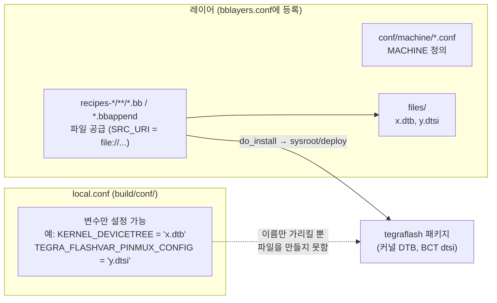
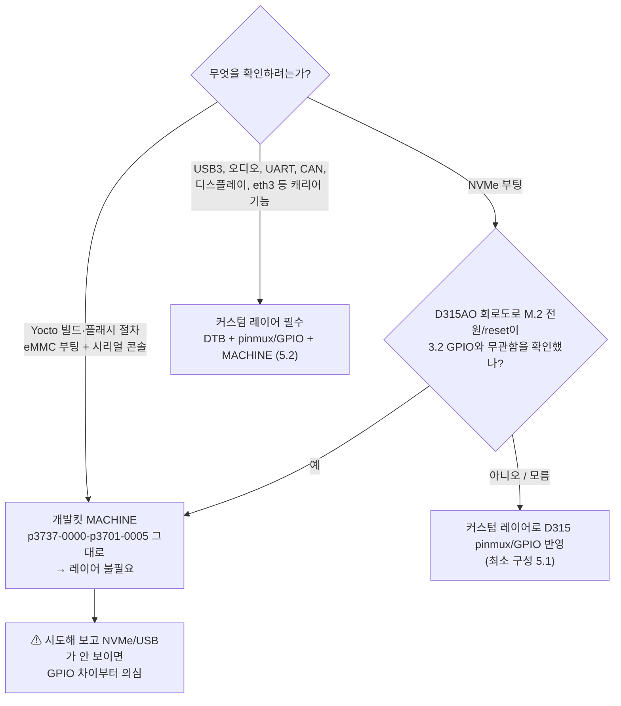

---
title:
source:
author:
published:
created: 2025-09-07
description:
tags:
---
# D315AO용 커스텀 레이어(meta-avermedia)는 필수인가?

> 기준: poky `scarthgap` + meta-tegra `scarthgap`(L4T R36.5.2),
> AVerMedia D315AO BSP(`JetPack_6.2.2_Linux_JETSON_desktop_in_docker/Linux_for_Tegra`, L4T R36.5.0),
> NVIDIA 순정 `Jetson_Linux_r36.5.0_aarch64.tbz2`.
> 아래 비교는 모두 이 파일들을 직접 `diff`/`dtc`로 비교한 결과입니다. **실제 보드로 시험한 결과는 아닙니다.**
> 관련 문서: [D315AO_BOARD_CONF_ANALYSIS.md](./D315AO_BOARD_CONF_ANALYSIS.md)

---

## 1. 결론

| 목적                                                                     | 커스텀 레이어    | 이유 요약                                                                                                                                          |
| ---------------------------------------------------------------------- | ---------- | ---------------------------------------------------------------------------------------------------------------------------------------------- |
| **Yocto 빌드·플래시 절차 연습, eMMC 기본 부팅 확인** (지금 가이드 범위)                      | **필수 아님**  | 모듈(P3701-0005), 부트로더, BCT(메모리/PMIC), BPMP DTB, 파티션 레이아웃, ODMDATA가 개발킷 MACHINE과 D315AO BSP에서 같음. 시리얼 콘솔(ttyTCU0)과 모듈 내장 eMMC로 부팅하는 데 필요한 설정이 같음 |
| **NVMe 부팅 확인**                                                         | **강하게 권장** | D315 pinmux는 MB1 단계에서 GPIO 10여 개를 출력 High/Low로 구동함. 이것이 캐리어의 전원 enable/reset 신호라면, 개발킷 설정으로는 M.2 슬롯 등이 켜지지 않을 수 있음. 회로도 없이는 판단 불가 (3.2)        |
| **D315AO를 제품으로 쓰는 이미지** (USB, 오디오, UART, CAN, 디스플레이, eth3 등 캐리어 기능 사용) | **필수**     | D315AO 전용 DTB와 pinmux/GPIO 설정 파일을 빌드에 **넣어야** 하는데, Yocto는 파일을 **레이어 안의 레시피**로만 받기 때문 (2장)                                                      |

정확히 말하면 필수인 것은 **"meta-avermedia라는 이름의 레이어"가 아니라 "D315AO 파일을 담은 내 레이어 하나"** 입니다. 이미 프로젝트 레이어(예: `meta-aicamsys`)가 있다면 그 안에 넣어도 됩니다. 다만 캐리어 BSP를 별도 레이어로 나누면 제품 레이어와 수명주기를 따로 관리할 수 있어서 보통 그렇게 합니다.

---

## 2. 제품 이미지에서 레이어가 필수인 이유

### 2.1 Yocto의 규칙: 설정은 conf로, 파일은 레시피로, 레시피는 레이어로



- `local.conf`는 **변수 값만** 정할 수 있습니다. `KERNEL_DEVICETREE = "tegra234-...-nv-d315.dtb"`라고 써도, 그 이름의 파일을 **만들어 내는** 레시피가 없으면 빌드는 "파일 없음"으로 실패하거나 경고를 내고 빠뜨립니다.
- 빌드에 파일을 넣으려면 레시피(`.bb`)나 기존 레시피의 확장(`.bbappend`)에서 `SRC_URI = "file://..."`로 받아 설치해야 합니다. 레시피와 bbappend는 `bblayers.conf`에 등록된 **레이어 안에만** 둘 수 있습니다(`BBFILES` 패턴이 레이어 디렉터리 기준).

### 2.2 D315AO에서 빌드에 넣어야 하는 파일과 지금 meta-tegra가 공급하는 파일

| 필요한 파일 | meta-tegra가 지금 넣는 것 | 차이 |
|---|---|---|
| 커널/UEFI DTB `tegra234-p3737-0000+p3701-0005-nv-d315.dtb` | `nvidia-kernel-oot-dtb` 레시피가 **NVIDIA 소스로 빌드한** `...-0005-nv.dtb` (`tegra-common.inc`: `PREFERRED_PROVIDER_virtual/dtb ?= "nvidia-kernel-oot-dtb"`) | D315 DTS는 NVIDIA 소스에 없음. AVerMedia BSP에도 **빌드된 DTB만** 있고 소스가 없음 |
| MB1 pinmux `tegra234-mb1-bct-pinmux-p3701-0000-a04.dtsi` (D315판) | `tegra-bootfiles` 레시피가 NVIDIA BSP tarball의 `bootloader/generic/BCT/tegra234*`를 **그대로** 설치 | 같은 파일 이름에 **NVIDIA 순정 내용**이 들어감 |
| MB1 GPIO `tegra234-mb1-bct-gpio-p3701-0000-a04.dtsi` (D315판) | 위 레시피가 `bootloader/tegra234-*.dts*`를 그대로 설치 | 같은 이름, **순정 내용** |
| MACHINE 정의 (`DTB`, `PINMUX` 변수) | `conf/machine/p3737-0000-p3701-0005.conf` (개발킷) | D315AO MACHINE 없음 |

meta-tegra가 받는 NVIDIA tarball은 **체크섬이 고정**돼 있습니다. tarball 안의 파일을 바꿔치기하는 방식(AVerMedia BSP가 `Linux_for_Tegra/`에서 한 방식)은 Yocto에서 쓸 수 없습니다. 그래서 **다른 이름의 파일을 내 레이어에서 추가로 설치**하고 MACHINE 변수로 그 이름을 가리켜야 합니다.

### 2.3 MACHINE 파일 위치

BitBake는 `BBPATH`의 각 디렉터리에서 `conf/machine/${MACHINE}.conf`를 찾습니다. 기술적으로는 `build/conf/machine/`에 넣어도 찾습니다(poky 기본 `BBPATH`에 `${TOPDIR}`이 들어가므로). 하지만 2.2의 **파일 공급은 어차피 레이어가 필요**하고, 빌드 디렉터리는 보통 버전 관리를 하지 않으므로 권장하지 않습니다.

### 2.4 레이어 대신 쓸 수 있는 방법과 그 문제

| 방법 | 동작 여부 | 문제 |
|---|---|---|
| **meta-tegra를 직접 수정** (`conf/machine/`에 추가, `tegra-bootfiles`에 파일 추가) | 동작함 | meta-tegra는 외부(OE4T) 저장소. 업데이트(`git pull`, R36.5.x → 다음 버전)할 때마다 충돌하거나 변경이 사라짐. 무엇을 바꿨는지 추적하기 어려움 |
| **local.conf만으로** 개발킷 MACHINE에 변수 덮어쓰기 | DTB/pinmux **파일을 넣을 수 없으므로** 캐리어 반영 불가 | 2.1 |
| **플래시 직전에 tegraflash 패키지 안의 파일을 손으로 바꿔치기** | 일회성으로는 가능 | 재현 불가. 서명/BUP(부트로더 업데이트 페이로드) 생성과 어긋날 수 있음. 빌드 결과물과 실제 플래시 내용이 달라짐 |
| **커스텀 레이어** | 동작함 | 레이어 골격(`layer.conf`)을 한 번 만들어야 함. 그 밖의 단점 없음. meta-tegra 공식 문서 `docs/Creating-a-custom-MACHINE.md`가 권장하는 방식 |

---

## 3. 개발킷 MACHINE을 D315AO에 그대로 쓰면 무엇이 달라지나

`p3737-0000-p3701-0005`(meta-tegra 개발킷 MACHINE)로 빌드하면 **NVIDIA 순정 DTB + 순정 pinmux/GPIO**가 D315AO 보드에 들어갑니다. 무엇이 다른지 파일을 직접 비교했습니다.

### 3.1 부트 체인 설정 — 같음 (기본 부팅이 될 것으로 보는 근거)

| 항목                                   | 개발킷 MACHINE (meta-tegra)                  | D315AO BSP (`jetson-agx-orin-d315ao.conf` 체인) |
| ------------------------------------ | ----------------------------------------- | --------------------------------------------- |
| 메모리 BCT (`EMMC_BCT`, `WB0SDRAM_BCT`) | `tegra234-p3701-0005-sdram-l4t.dts`       | 같음                                            |
| PMIC                                 | `tegra234-mb1-bct-pmic-p3701-0005.dts`    | 같음                                            |
| BPMP DTB                             | `tegra234-bpmp-3701-0005-3737-0000.dtb`   | 같음                                            |
| 파티션 레이아웃                             | `flash_t234_qspi_sdmmc.xml`               | 같음                                            |
| ODMDATA (UPHY 레인)                    | `gbe-uphy-config-22,hsstp-lane-map-3,...` | 같음                                            |
| padvoltage (`PMC_CONFIG`)            | `...padvoltage-p3701-0000-a04.dtsi`       | 같음 (AVerMedia가 안 바꿈)                          |
| `p3701.conf.common`                  | —                                         | 순정과 바이트 단위로 같음                                |

메모리 초기화, 전원, BPMP, 부트 저장장치(QSPI + 모듈 내장 eMMC), 디버그 UART(ttyTCU0)는 모두 **모듈 쪽** 자원이고 설정도 같습니다. 그래서 eMMC 부팅과 시리얼 콘솔은 개발킷 MACHINE으로도 동작할 가능성이 높다고 판단합니다. (추정입니다. 실제 보드에서는 아직 확인하지 않았습니다.)

### 3.2 MB1 GPIO 기본값 — 다름 ⚠ (가장 큰 위험)

순정 `tegra234-mb1-bct-gpio-p3701-0000-a04.dtsi`와 D315판을 핀 단위로 비교했습니다. 핀은 **부팅 초기(MB1)** 에 아래 상태가 됩니다.

| GPIO                                   | 순정 (개발킷) | D315AO              | 개발킷 설정을 쓰면  |
| -------------------------------------- | -------- | ------------------- | ----------- |
| `MAIN AG,1`                            | 입력       | **출력 High**         | 구동 안 됨      |
| `MAIN E,0`, `E,1`                      | (미설정)    | **출력 High**         | 구동 안 됨      |
| `MAIN A,6`                             | (미설정)    | **출력 High**         | 구동 안 됨      |
| `MAIN AG,2`, `AG,6`, `AG,7`            | 입력       | **출력 Low**          | 입력으로 남음     |
| `MAIN K,0`, `K,1`                      | 입력       | **출력 Low**          | 입력으로 남음     |
| `MAIN A,5`, `X,5`, `AON EE,1`          | (미설정)    | **출력 Low**          | 구동 안 됨      |
| `MAIN E,4`, `E,6`, `F,0`, `G,5`, `M,0` | (미설정)    | 입력                  | 미설정         |
| `AON AA,0`, `AA,1`                     | 입력       | (GPIO 아님 → CAN0 기능) | CAN0 동작 안 함 |

부트로더가 출력 High/Low로 정하는 핀은 보통 **캐리어 쪽 부품의 전원 enable, reset, mux 선택** 신호입니다. 이 핀이 무엇에 연결됐는지는 **D315AO 회로도가 있어야** 알 수 있습니다. 예를 들어 이 중 하나가 M.2(NVMe) 슬롯 전원, USB 허브 reset, 이더넷 PHY reset이라면, 개발킷 설정으로는 **그 장치가 아예 보이지 않을 수 있습니다.** NVMe 부팅을 확인하기 전에 커스텀 레이어를 권장하는 이유가 이것입니다.

### 3.3 MB1 pinmux — 다름 (주요 항목)

| 핀 | 순정 (개발킷) | D315AO |
|---|---|---|
| `can0_dout_paa0`, `can0_din_paa1` | (GPIO 입력) | **CAN0** |
| UART 계열 핀 일부 | `uartb`, `uarti` | `rsvd1`, `uarte` |
| DP 관련 핀 | `dp` | `rsvd1` |
| `dp_aux_ch1_hpd_pm1`, `dp_aux_ch2_hpd_pm2` | (DP HPD) | **`eth3`** |

### 3.4 커널 DTB — 다름

`dtc`로 두 DTB(`...-0005-nv.dtb` 순정, `...-0005-nv-d315.dtb`)를 풀어 노드/속성 단위로 비교했습니다. phandle 번호가 바뀐 것만 다른 항목(수백 개)은 빼고, 실제 의미가 바뀐 것만 정리했습니다.

| 영역 | 순정 (개발킷) | D315AO | 개발킷 DTB를 쓰면 |
|---|---|---|---|
| `model` | `NVIDIA Jetson AGX Orin Developer Kit` | `NVIDIA Jetson AGX Orin 64GB - AVerMedia D315` | 표시 이름만 다름 |
| USB Type-C 컨트롤러 (`i2c@c240000/typec@8`, Cypress CYPD4226 UCSI) | 있음, `okay` | **없음** | 없는 칩을 찾느라 커널 로그에 I2C 오류. 기능 영향은 작음 |
| USB 포트 0 (`padctl usb2-0`) | `otg` (Type-C 역할 전환) | `peripheral` + connector | 장치 모드(USB 가젯/플래시 포트) 동작이 다를 수 있음 |
| USB3 ↔ USB2 짝 (`usb3-0/1/2 : nvidia,usb2-companion`) | 1 / 0 / 3 | 3 / 2 / 1 | **USB3 포트가 엉뚱한 USB2 포트와 짝지어져** USB3 장치가 USB2 속도로 붙거나 인식되지 않을 수 있음 |
| UARTE (`serial@3140000`) | `disabled` | `okay` (hsuart) | 캐리어의 UART 포트 하나가 안 생김 |
| 오디오 코덱 (`i2c@31e0000`) | Realtek RT5640 `audio-codec@1c` | **TI `tlv320aic3101@18`** | 오디오 안 됨 |
| 디스플레이 DCB (`display@13800000 : nvidia,dcb-image`) | 개발킷용 | 내용 다름 | 디스플레이 출력 구성(DP/HDMI 포트 매핑)이 맞지 않을 수 있음 |
| PCIe 컨트롤러, MGBE 이더넷, eMMC (`mmc@3460000`) | — | **차이 없음** (phandle 번호만 다름) | 영향 없음 |

PCIe 컨트롤러 구성이 DTB 수준에서는 같습니다. 그래서 **NVMe 문제가 생긴다면 DTB가 아니라 3.2의 GPIO(전원/reset) 쪽**일 가능성이 큽니다.

---

## 4. 판단 흐름



---

## 5. 레이어에 들어갈 것

### 5.1 최소 구성 — 부트로더 단계 핀 설정만 반영

```
meta-avermedia/
├── conf/layer.conf                         # BBFILE_COLLECTIONS, LAYERSERIES_COMPAT = "scarthgap", LAYERDEPENDS = "tegra"
├── conf/machine/jetson-agx-orin-d315ao.conf
│     require conf/machine/p3737-0000-p3701-0005.conf          # 64GB 개발킷 MACHINE 값 전부 상속
│     TEGRA_FLASHVAR_PINMUX_CONFIG = "tegra234-mb1-bct-pinmux-d315ao.dtsi"
└── recipes-bsp/tegra-binaries/
      ├── tegra-bootfiles_%.bbappend         # 아래 두 파일을 ${datadir}/tegraflash/ 에 추가 설치
      └── files/
          ├── tegra234-mb1-bct-pinmux-d315ao.dtsi   # D315판 pinmux, #include 줄을 아래 이름으로 수정
          └── tegra234-mb1-bct-gpio-d315ao.dtsi     # D315판 gpio
```

- **파일 이름을 바꾸는 이유:** 순정과 같은 이름으로 설치하면 `tegra-bootfiles`가 이미 설치한 순정 파일과 경로가 겹칩니다. 그러면 어느 쪽이 남을지 보장되지 않거나 파일 충돌 오류가 납니다. meta-tegra 문서도 `tegra234-`로 시작하는 고유한 이름을 쓰라고 합니다.
- MACHINE 이름은 31자 이하여야 합니다(부트로더 업데이트 페이로드 제약). `jetson-agx-orin-d315ao`는 22자입니다.
- `TEGRA_BOARDSKU`, BCT, PMIC, BPMP DTB는 상속값(0005)이 D315AO BSP와 같으므로 다시 쓸 필요가 없습니다(3.1).
- meta-tegra 문서는 커스텀 pinmux를 `tegra-flashvars` 레시피 쪽에 넣는 예를 보여 줍니다. 어느 레시피에 넣을지는 레이어를 실제로 만들 때 빌드로 확인합니다.

### 5.2 전체 구성 — 커널 DTB까지 반영

5.1에 더해 다음이 필요합니다.

```
│     KERNEL_DEVICETREE = "tegra234-p3737-0000+p3701-0005-nv-d315.dtb"
└── recipes-kernel/nvidia-kernel-oot/
      └── nvidia-kernel-oot-dtb_%.bbappend   # D315 DTS를 소스 트리에 추가해 빌드
          files/tegra234-p3737-0000+p3701-0005-nv-d315.dts(i)   ← AVerMedia에서 받아야 함
```

**막혀 있는 점: D315 DTS 소스가 없습니다.** 선택지는 세 가지입니다.

| 방법                                                          | 장점                                                   | 단점                                                       |
| ----------------------------------------------------------- | ---------------------------------------------------- | -------------------------------------------------------- |
| **AVerMedia에 DTS 소스 요청** (권장)                               | 정석. meta-tegra 커널(R36.5.2)과 같이 빌드되어 버전이 맞음. 이후 수정 가능 | 받기까지 시간이 걸림                                              |
| BSP의 빌드된 `.dtb`를 레시피로 설치하고 `EXTERNAL_KERNEL_DEVICETREE`로 넘김 | 바로 할 수 있음                                            | R36.5.0 커널용 DTB를 R36.5.2 커널에 씀. 바인딩이 다르면 드라이버 오동작. 수정 불가 |
| `.dtb`를 `dtc`로 역컴파일해 DTS로 씀                                 | 소스 형태로 관리 가능                                         | phandle이 숫자로 풀려 있어 사람이 고치기 어려움. 매크로/주석 손실. 유지보수 부담 큼     |

---

## 6. 권장 진행 순서

1. **지금 가이드대로 개발킷 MACHINE(`p3737-0000-p3701-0005`)으로 eMMC 부팅을 먼저 확인합니다.** 레이어 없이 Yocto 빌드/플래시 경로 자체를 검증하는 단계입니다.
2. 부팅되면 보드에서 `lsusb -t`, `lspci`, `dmesg | grep -i -E 'nvme|pcie|typec|ucsi'`로 3장의 차이가 실제로 어떻게 나타나는지 기록합니다.
3. **NVMe 확인 전에 5.1 최소 레이어를 만듭니다.** D315 pinmux/GPIO를 반영한 뒤 NVMe를 시험합니다.
4. 동시에 **AVerMedia에 D315 DTS 소스(커널 DT + 필요하면 BPMP DT)를 요청합니다.** 받으면 5.2로 넘어갑니다.

## 7. 확인하지 못한 것

- 실제 D315AO 보드에서 개발킷 MACHINE으로 부팅한 결과 (3.1의 "부팅될 것"은 설정 비교에 근거한 추정)
- 3.2 GPIO 핀이 캐리어의 어느 신호에 연결되는지 (D315AO 회로도 필요)
- 5.1에서 pinmux 파일을 `tegra-bootfiles`와 `tegra-flashvars` 중 어디에 넣어야 빌드가 통과하는지 (레이어 작성 단계에서 빌드로 확인)