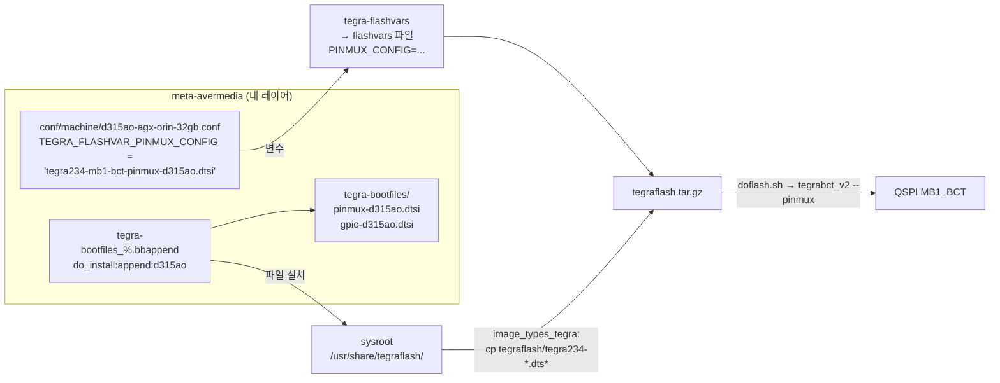

---
title:
source:
author:
published:
created: 2025-09-07
description:
tags:
---
# D315AO 3단계 가이드 — 최소 커스텀 레이어(`meta-avermedia`)로 MB1 pinmux/GPIO 반영

이 문서는 [`../sdk-analysis/D315AO_CUSTOM_LAYER_NECESSITY.md`](../sdk-analysis/D315AO_CUSTOM_LAYER_NECESSITY.md)의 **권장 순서 3단계**("NVMe 확인 전에 5.1 최소 레이어를 만든다")를 실행하기 위한 가이드다.

> 3단계: D315AO 전용 MACHINE과 레이어를 만들어 **부트로더(MB1) 단계의 pinmux/GPIO를 AVerMedia BSP 값으로** 바꾼다. 그 상태에서 eMMC 부팅을 다시 확인하고 NVMe/PCIe가 보이는지 시험한다.

프롬프트 표기와 경로는 1단계 가이드 [`D315AO_EMMC_BOOT_WITH_DEVKIT_MACHINE.md`](./D315AO_EMMC_BOOT_WITH_DEVKIT_MACHINE.md)와 같다.

| 표기 | 실행 위치 |
|------|-----------|
| `host$` | Ubuntu 24.04 호스트 (`louis`) |
| `ctr$` | Ubuntu 22.04 컨테이너 `prj-aicamsys-medspa-js-22.04` (사용자 `dinsight`) |
| `d315#` | D315AO 시리얼 콘솔 (root) |

| 변수 | 호스트 값 | 컨테이너 값 |
|------|-----------|-------------|
| `$YROOT` | `/home/louis/work/project/jeisys-medical/aicamsys-medspa-js/sdk/AVerMedia/Yocto/scarthgap` | `/home/1000/work/project/jeisys-medical/aicamsys-medspa-js/sdk/AVerMedia/Yocto/scarthgap` |
| `$BSP` | `/home/louis/work/project/jeisys-medical/aicamsys-medspa-js/sdk/AVerMedia/JetPack_6.2.2_Linux_JETSON_desktop_in_docker/Linux_for_Tegra` | (호스트에서만 쓴다) |

---

## 0. 범위와 전제

### 0.1 이 단계에서 바꾸는 것 / 바꾸지 않는 것

| 바꾼다 | 바꾸지 않는다 (이후 단계) |
|--------|---------------------------|
| MB1 pinmux (`TEGRA_FLASHVAR_PINMUX_CONFIG`) → D315판 | 커널 DTB (USB 포트 짝, 오디오 코덱, UARTE, 디스플레이 DCB, Type-C). D315 DTS 소스가 필요하다(분석 문서 5.2) |
| MB1 GPIO 기본값 (pinmux 파일이 `#include`) → D315판 | NVMe **부팅**(rootfs를 NVMe로). 이번에는 NVMe가 **보이는지**만 본다 |
| `nvpmodel` 설정 → SKU 0004용 ([ISSUE-002](../sdk-debugging/ISSUE-002_nvpmodel_wrong_conf_sku0004.md) 조치) | 메모리 BCT, PMIC, BPMP DTB, 파티션 레이아웃, ODMDATA, padvoltage (1.2: D315AO BSP와 이미 같다) |
| MACHINE 이름 → `d315ao-agx-orin-32gb` | 이미지 내용(`core-image-base`, 1단계와 같은 패키지) |

플래시 결과로 보면 바뀌는 파티션은 QSPI의 **`MB1_BCT`(A/B)** 다(1단계 가이드 7.3.4). rootfs에서는 `/etc/nvpmodel.conf` 하나가 바뀐다.

### 0.2 통과 기준

1. `bitbake core-image-base` 가 새 MACHINE으로 에러 없이 끝난다.
2. 플래시 로그에 `tegra234-mb1-bct-pinmux-d315ao.dtsi` 가 쓰이고 `Flashing completed` 로 끝난다.
3. 1단계와 똑같이 eMMC(`/dev/mmcblk0p1`)로 부팅된다. **pinmux를 바꿨기 때문에 이것이 가장 먼저 확인할 항목이다.**
4. `nvpmodel.service` 가 실패 목록에서 사라진다.
5. GPIO 상태가 6.3 표의 D315AO 값과 맞는다.
6. NVMe/PCIe 결과(보이든 안 보이든)를 기록한다. **NVMe가 안 보여도 이 단계는 실패가 아니다.** 판단에 필요한 자료를 얻는 것이 목적이다(6.4).

### 0.3 이 문서를 쓰면서 실제로 확인한 것 (2026-11-24)

이 가이드의 레이어를 임시 위치(`$YROOT/.verify-step3/`)에 그대로 만들어 컨테이너에서 빌드했다.

| 확인 | 결과 |
|------|------|
| 레이어 파싱, `bitbake-layers show-layers` | `avermedia` 우선순위 10으로 등록됨 |
| `bitbake-getvar` (3.3의 표) | 표의 기대값과 모두 일치 |
| `tegra-bootfiles` 의 sysroot | `tegra234-mb1-bct-pinmux-d315ao.dtsi`, `tegra234-mb1-bct-gpio-d315ao.dtsi` 설치됨. 레이어 파일과 바이트 단위로 같음 |
| `tegra-flashvars` 의 `flashvars` | `PINMUX_CONFIG="tegra234-mb1-bct-pinmux-d315ao.dtsi"`, `CHECK_BOARDSKU="0004"` |
| `tegra-nvpmodel-base` 패키지의 `/etc/nvpmodel.conf` | L4T deb의 `nvpmodel_p3701_0004.conf` 와 같음 |
| `bitbake core-image-base` | ✅ 성공(8077 태스크 중 7168개는 sstate 재사용). `tegraflash.tar.gz` 안에 D315 dtsi 두 개와 `PINMUX_CONFIG="tegra234-mb1-bct-pinmux-d315ao.dtsi"`, `doflash.sh` 첫 줄 `MACHINE=d315ao-agx-orin-32gb` |
| pinmux 전처리·컴파일 | 플래시 도구와 같은 방식(`cpp -x assembler-with-cpp` → `dtc`)으로 D315 pinmux를 컴파일했다. 성공했고, 경고(`unit_address_vs_reg`)는 순정 파일과 같은 종류다. `#include` 된 GPIO도 D315판(`gpio-output-high` 에 `AG,1` 등)으로 들어갔다. 빌드 과정에서는 MB1 BCT를 만들지 않으므로(플래시 때 만든다) 따로 확인했다 |

**확인하지 못한 것:** 실제 보드에 플래시한 결과. 이 문서의 5장 이후가 그 절차다.

### 0.4 시작하기 전에 할 일 — 1단계 이미지에서 로그 먼저 받기

3단계 플래시는 QSPI와 eMMC를 다시 쓴다. **비교 기준(개발킷 pinmux 상태의 GPIO, lspci 등)은 1단계 이미지가 올라가 있는 지금만 받을 수 있다.**

```bash
d315# mkdir -p /root/step1 && cd /root/step1
d315# dmesg > dmesg.txt; lsusb -t > lsusb-t.txt; lspci -vv > lspci.txt 2>&1
d315# systemctl --failed > failed.txt; cat /sys/kernel/debug/gpio > gpio.txt 2>&1
d315# cat /proc/device-tree/model > model.txt; ip -br link > link.txt
d315# journalctl -b -u nvpmodel --no-pager > nvpmodel.txt; nproc > nproc.txt; df -h / > df.txt
```

호스트로 가져온다(이더넷이 안 되면 시리얼 콘솔 로그에서 복사한다).

```bash
host$ scp -r root@<D315AO_IP>:/root/step1 $YROOT/flash/d315ao-step1-logs
```

**왜?**
- 1단계 가이드 8.4와 같은 명령에, REPORT-001에서 남은 확인(`nvpmodel` 로그, `nproc`, `df`)을 더했다.
- 3단계 결과를 "D315 pinmux를 넣어서 바뀐 것"과 "원래 그랬던 것"으로 나누려면 같은 명령의 **변경 전** 출력이 필요하다.
- 이미 3단계 플래시를 해 버렸다면, 1단계 패키지(`$YROOT/flash/d315ao-step1-emmc`)로 다시 플래시해서 받을 수 있다(8장).

---

## 1. 설계 — 무엇을 왜 이렇게 만드나

### 1.1 Yocto에서 pinmux를 바꾸는 방법 (meta-tegra 공식 방식)

출처: `meta-tegra/docs/Creating-a-custom-MACHINE.md` "Jetson Orin" 절.



- **변수**(어떤 파일을 쓸지)는 MACHINE conf의 `TEGRA_FLASHVAR_PINMUX_CONFIG` 로 정한다. scarthgap부터 `flashvars` 파일은 `tegra-flashvars` 레시피가 이 변수로 자동 생성한다.
- **파일**은 `tegra-bootfiles` 레시피를 bbappend해서 `${datadir}/tegraflash/` 에 추가 설치한다. 이미지 클래스(`image_types_tegra.bbclass`)가 그 디렉터리의 `tegra234-*.dts*` 를 플래시 패키지로 복사한다. 그래서 **파일 이름이 `tegra234-` 로 시작해야 한다.**
- GPIO 파일은 변수에 넣지 않는다. pinmux 파일이 `#include` 로 불러오기 때문이다(meta-tegra 문서의 NOTE).

### 1.2 SKU 0004 기준 재확인 — D315AO BSP와 무엇이 같고 다른가

분석 문서(3.1)는 64GB(SKU 0005) 기준이었다. 실제 모듈은 **32GB(SKU 0004)** 이므로 다시 비교했다.

**비교 방법:** NVIDIA 순정 `Jetson_Linux_r36.5.0_aarch64.tbz2` 의 `bootloader/tegra234-*`, `bootloader/generic/*`, `kernel/dtb/tegra234-p3737*`, `p3701.conf.common`, `jetson-agx-orin-devkit.conf`(555개 파일)를 D315AO BSP(`$BSP`)와 `cmp` 로 비교했다.

| 다른 파일 | 판단 |
|-----------|------|
| `bootloader/generic/BCT/tegra234-mb1-bct-pinmux-p3701-0000-a04.dtsi` | **AVerMedia 변경. 이번에 반영한다** |
| `bootloader/tegra234-mb1-bct-gpio-p3701-0000-a04.dtsi` | **AVerMedia 변경. 이번에 반영한다** |
| `bootloader/tegra234-br-bct-diag-boot.dts` | `preprod_dev_sign` 1→0. 파일 시각이 2026-11-23 15:27로, BSP로 플래시할 때 `flash.sh` 가 고쳐 쓴 것이다. AVerMedia 변경이 아니다 |
| `bootloader/generic/BCT/tegra234-mb2-bct-scr-p3767-0000.dts` | Orin NX/Nano(P3767)용. AGX Orin과 무관 |

그 밖에 D315AO BSP에는 **새 파일**로 D315 커널 DTB(`kernel/dtb/tegra234-p3737-0000+p3701-000{0,4,5,8}-nv-d315.dtb`)가 있다(5.2 단계 대상).

SKU 0004일 때 각 BSP가 고르는 부트 설정:

| 항목 | D315AO BSP (`jetson-agx-orin-d315ao.conf` → `jetson-agx-orin-devkit.conf` → `p3701.conf.common`) | meta-tegra `p3737-0000-p3701-0004` | 같은가 |
|------|------|------|------|
| 메모리 BCT | SKU 0005/0008만 바꾸고 0004는 기본값 `tegra234-p3701-0000-sdram-l4t.dts` | `EMMC_BCT` = `tegra234-p3701-0000-sdram-l4t.dts` | ✅ |
| PMIC | 0004: `tegra234-mb1-bct-pmic-p3701-0005.dts` | `TEGRA_FLASHVAR_PMIC_CONFIG` = 같은 파일 | ✅ |
| BPMP DTB | 0004: `tegra234-bpmp-3701-0004-3737-0000.dtb` | `flashvars` 에는 `...-0000-...` 로 적히지만, 1단계 `doflash.log` 에서 플래시 도구가 SKU를 읽고 **`tegra234-bpmp-3701-0004-3737-0000.dtb`** 를 썼다 | ✅ |
| pinmux | FAB 500이라 예외 목록(TS*/EB*/000/100/200)에 해당하지 않음 → `...pinmux-p3701-0000-a04.dtsi` (**D315판**) | `...pinmux-p3701-0000-a04.dtsi` (**순정**) | ❌ → 이번에 해결 |
| padvoltage | `...padvoltage-p3701-0000-a04.dtsi` (순정과 같음) | 같은 파일 | ✅ |
| 커널 DTB | 0004: `tegra234-p3737-0000+p3701-0004-nv-d315.dtb` | `tegra234-p3737-0000+p3701-0004-nv.dtb` | ❌ (5.2 단계) |

**버전 차이도 확인했다.** AVerMedia BSP는 R36.5.0, meta-tegra는 R36.5.2다. 순정 pinmux/GPIO/padvoltage 세 파일은 **R36.5.0과 R36.5.2가 바이트 단위로 같다.** 그래서 D315판 파일을 R36.5.2에 그대로 써도 된다.

### 1.3 레이어 구조

```
$YROOT/meta-avermedia/
├── conf/
│   ├── layer.conf
│   └── machine/
│       ├── include/d315ao.inc                 # 모든 D315AO MACHINE 공통 (override 이름, pinmux)
│       └── d315ao-agx-orin-32gb.conf          # SKU 0004용 MACHINE
└── recipes-bsp/tegra-binaries/
    ├── tegra-bootfiles_%.bbappend             # dtsi 두 개를 /usr/share/tegraflash 에 설치
    └── tegra-bootfiles/
        ├── tegra234-mb1-bct-pinmux-d315ao.dtsi    # $BSP 파일 복사 + #include 한 줄 수정
        └── tegra234-mb1-bct-gpio-d315ao.dtsi      # $BSP 파일 복사
```

**설계 선택과 이유**

| 선택 | 이유 |
|------|------|
| 위치 `$YROOT/meta-avermedia` (meta-tegra 옆) | meta-tegra를 고치지 않는다. 외부 저장소라 업데이트할 때 변경이 사라진다(분석 문서 2.4) |
| MACHINE `d315ao-agx-orin-32gb` | 캐리어(D315AO)와 모듈(32GB)이 이름에 다 드러난다. 20자로 meta-tegra 제한(31자 이하)을 지킨다. 64GB 모듈을 쓰게 되면 `d315ao-agx-orin-64gb.conf` 를 추가한다(부록 A) |
| `require conf/machine/p3737-0000-p3701-0004.conf` | 1단계에서 부팅을 확인한 설정을 **전부 물려받고**, 필요한 것만 덮어쓴다. meta-tegra에는 개발킷 MACHINE 이름(`:p3737-0000-p3701-0004`)에 걸린 override가 없다(전체 grep으로 확인). 그래서 `MACHINEOVERRIDES` 에 개발킷 이름을 넣을 필요가 없다 |
| `MACHINEOVERRIDES =. "d315ao:"` (`.inc`) | 32GB/64GB MACHINE이 모두 `:d315ao` 하나로 bbappend를 공유한다. `=.` 는 앞에 붙이므로 MACHINE 이름 override보다 우선순위가 낮다 |
| 파일 이름 `tegra234-mb1-bct-{pinmux,gpio}-d315ao.dtsi` | 순정과 같은 이름으로 설치하면 `tegra-bootfiles` 가 이미 설치한 순정 파일과 겹친다. `tegra234-` 접두어는 1.1의 복사 규칙 때문에 필요하다 |
| `TEGRA_FLASHVAR_PINMUX_CONFIG = ...` (`?=` 아님) | 상위 conf가 `?=` 로 기본값을 준다. 내 MACHINE에서는 반드시 이 값이어야 하므로 `=` 로 확정한다 |
| `NVPMODEL = "nvpmodel_p3701_0004"` | meta-tegra 기본값(`tegra234.inc`)은 12코어용 `nvpmodel_p3701_0000`. SKU 0004(8코어)에 맞춘다(ISSUE-002). SKU마다 다르므로 `.inc` 가 아니라 MACHINE conf에 둔다 |
| `BBFILE_PRIORITY_avermedia = "10"` | meta-tegra(5)보다 높게 해서, 나중에 같은 이름의 레시피/파일을 넣으면 내 레이어가 이기게 한다 |

---

## 2. 레이어 만들기 (호스트)

레이어는 일반 파일이라 호스트에서 만든다. 컨테이너는 같은 디렉터리를 보고 있다(1단계 가이드 1.3).

### 2.1 디렉터리

```bash
host$ YROOT=/home/louis/work/project/jeisys-medical/aicamsys-medspa-js/sdk/AVerMedia/Yocto/scarthgap
host$ BSP=/home/louis/work/project/jeisys-medical/aicamsys-medspa-js/sdk/AVerMedia/JetPack_6.2.2_Linux_JETSON_desktop_in_docker/Linux_for_Tegra
host$ cd $YROOT && ls -d meta-avermedia 2>/dev/null || echo "new"
host$ mkdir -p meta-avermedia/conf/machine/include meta-avermedia/recipes-bsp/tegra-binaries/tegra-bootfiles
```

**왜?** `ls -d` 가 `new` 를 출력해야 한다. 이미 있으면 덮어쓰기 전에 내용을 확인한다.

### 2.2 `conf/layer.conf`

```bash
host$ cat > meta-avermedia/conf/layer.conf <<'EOF'
# meta-avermedia: AVerMedia D315AO carrier board support for meta-tegra (scarthgap)
BBPATH .= ":${LAYERDIR}"
BBFILES += " \
    ${LAYERDIR}/recipes-*/*/*.bb \
    ${LAYERDIR}/recipes-*/*/*.bbappend \
"

BBFILE_COLLECTIONS += "avermedia"
BBFILE_PATTERN_avermedia = "^${LAYERDIR}/"
BBFILE_PRIORITY_avermedia = "10"

LAYERVERSION_avermedia = "1"
LAYERDEPENDS_avermedia = "core tegra"
LAYERSERIES_COMPAT_avermedia = "scarthgap"
EOF
```

```bash
# meta-avermedia: AVerMedia D315AO carrier board support for meta-tegra (scarthgap)
# 주석: 레이어의 목적(AVerMedia D315AO 캐리어 보드 지원)과 대상 버전(scarthgap)을 명시합니다.

BBPATH .= ":${LAYERDIR}"
# BitBake가 설정 파일(.conf)이나 클래스(.bbclass)를 찾을 때 이 레이어의 경로를 검색 범위에 추가합니다.

BBFILES += " \
    ${LAYERDIR}/recipes-*/*/*.bb \
    ${LAYERDIR}/recipes-*/*/*.bbappend \
"
# BitBake가 읽어야 할 레시피(.bb)와 레시피 수정 파일(.bbappend)의 경로 패턴을 지정합니다.

BBFILE_COLLECTIONS += "avermedia"
# 이 레이어에 포함된 모든 레시피들을 'avermedia'라는 이름의 컬렉션으로 그룹화합니다.

BBFILE_PATTERN_avermedia = "^${LAYERDIR}/"
# 'avermedia' 컬렉션에 속하는 파일들이 어떤 경로 패턴을 가져야 하는지 정의합니다.

BBFILE_PRIORITY_avermedia = "10"
# 레이어의 우선순위를 설정합니다. 숫자가 높을수록 우선순위가 높으며, meta-tegra(기본값 5)보다 높게 설정하여 동일 레시피 존재 시 이 레이어의 설정이 적용되도록 합니다.

LAYERVERSION_avermedia = "1"
# 레이어의 버전 번호입니다.

LAYERDEPENDS_avermedia = "core tegra"
# 이 레이어가 작동하기 위해 반드시 먼저 로드되어야 하는 의존 레이어를 명시합니다 (Poky core 및 meta-tegra).

LAYERSERIES_COMPAT_avermedia = "scarthgap"
# 이 레이어가 호환되는 Y
```

**왜?**
- `BBPATH .= ":${LAYERDIR}"` : BitBake가 이 레이어의 `conf/machine/*.conf` 를 찾을 수 있게 한다.
- `BBFILES` : `recipes-*/*/` 아래의 `.bb`/`.bbappend` 를 읽는다. 1.3의 bbappend 위치(`recipes-bsp/tegra-binaries/`)가 이 패턴에 맞는다.
- `LAYERDEPENDS ... tegra` : meta-tegra 없이 이 레이어만 추가하면 바로 에러를 낸다.
- `LAYERSERIES_COMPAT ... scarthgap` : poky 버전과 맞지 않으면 경고 대신 에러를 낸다.
- 형식은 meta-tegra의 `conf/layer.conf` 를 따랐다.
- `<<'EOF'` 처럼 따옴표를 붙이면 셸이 `${LAYERDIR}` 를 바꾸지 않고 그대로 파일에 쓴다.

### 2.3 MACHINE 정의

```bash
host$ cat > meta-avermedia/conf/machine/include/d315ao.inc <<'EOF'
# Common settings for AVerMedia D315AO carrier (all AGX Orin SKUs).
# Include this AFTER requiring the meta-tegra devkit MACHINE conf.

# One override name for every D315AO MACHINE (used by the bbappend).
MACHINEOVERRIDES =. "d315ao:"

# MB1 pinmux/GPIO from the AVerMedia BSP (R36.5.0). The pinmux file
# #includes the GPIO file, so only the pinmux file is listed here.
TEGRA_FLASHVAR_PINMUX_CONFIG = "tegra234-mb1-bct-pinmux-d315ao.dtsi"
EOF

host$ cat > meta-avermedia/conf/machine/d315ao-agx-orin-32gb.conf <<'EOF'
#@TYPE: Machine
#@NAME: AVerMedia D315AO with Jetson AGX Orin 32GB
#@DESCRIPTION: AVerMedia D315AO carrier + P3701-0004 module (step 3: MB1 pinmux/GPIO only)

require conf/machine/p3737-0000-p3701-0004.conf
require conf/machine/include/d315ao.inc

# SKU 0004 = 8 CPU cores. meta-tegra default is the 12-core profile (ISSUE-002).
NVPMODEL = "nvpmodel_p3701_0004"
EOF
```

**왜?** 설계 이유는 1.3 표에 있다.
- `require` 순서가 중요하다. 개발킷 conf를 먼저 읽고 `.inc` 를 나중에 읽어야 `.inc` 의 값이 남는다.
- `KERNEL_DEVICETREE` 는 일부러 덮어쓰지 않는다. 개발킷 DTB(`...-0004-nv.dtb`)를 그대로 쓰므로, 1단계와 비교했을 때 바뀐 것은 pinmux/GPIO와 nvpmodel뿐이다.

### 2.4 pinmux/GPIO 파일 복사

```bash
host$ F=meta-avermedia/recipes-bsp/tegra-binaries/tegra-bootfiles
host$ cp $BSP/bootloader/generic/BCT/tegra234-mb1-bct-pinmux-p3701-0000-a04.dtsi $F/tegra234-mb1-bct-pinmux-d315ao.dtsi
host$ cp $BSP/bootloader/tegra234-mb1-bct-gpio-p3701-0000-a04.dtsi              $F/tegra234-mb1-bct-gpio-d315ao.dtsi
host$ sed -i 's|#include "tegra234-mb1-bct-gpio-p3701-0000-a04.dtsi"|#include "tegra234-mb1-bct-gpio-d315ao.dtsi"|' $F/tegra234-mb1-bct-pinmux-d315ao.dtsi
host$ grep -n '#include' $F/*.dtsi
host$ file $F/*.dtsi
host$ sha256sum $BSP/bootloader/generic/BCT/tegra234-mb1-bct-pinmux-p3701-0000-a04.dtsi $BSP/bootloader/tegra234-mb1-bct-gpio-p3701-0000-a04.dtsi | cut -c1-16
```

기대 출력:

```
...gpio-d315ao.dtsi:32:#include "tegra234-gpio.h"
...pinmux-d315ao.dtsi:33:#include "pinctrl-tegra.h"
...pinmux-d315ao.dtsi:34:#include "tegra234-mb1-bct-gpio-d315ao.dtsi"
...: C source, ASCII text            (두 파일 모두. "with CRLF" 가 붙으면 안 된다)
70ad15b90acdf608                     (pinmux 원본)
583bedf98746706d                     (gpio 원본)
```

**왜?**
- **파일 출처:** D315AO BSP가 실제로 플래시에 쓰는 경로다. pinmux는 `bootloader/generic/BCT/`, GPIO는 `bootloader/` 에 있다.
- **`sed`:** pinmux 파일 34번째 줄이 GPIO 파일을 원래 이름으로 `#include` 한다. 이름을 바꿨으니 이 줄도 바꿔야 한다. 안 바꾸면 **순정 GPIO 파일**이 조용히 포함된다. 같은 이름의 순정 파일이 플래시 패키지에 있어서 에러도 나지 않으므로 반드시 `grep` 으로 확인한다.
- `pinctrl-tegra.h`, `tegra234-gpio.h` 는 순정 파일도 쓰는 헤더라 플래시 패키지에 이미 있다(0.3에서 sysroot에 있는 것을 확인했다).
- **`file`:** meta-tegra 문서는 엑셀에서 만든 파일의 CRLF 줄바꿈을 `dos2unix` 로 고치라고 한다. 이 두 파일은 이미 LF다.
- **`sha256sum`:** 이 가이드를 쓸 때 쓴 BSP 파일과 같은지 확인한다. 다르면 BSP가 바뀐 것이니 1.2 비교를 다시 한다.

### 2.5 `tegra-bootfiles` bbappend

```bash
host$ cat > meta-avermedia/recipes-bsp/tegra-binaries/tegra-bootfiles_%.bbappend <<'EOF'
# Install D315AO MB1 pinmux/GPIO dtsi into ${datadir}/tegraflash.
# do_fetch is disabled for tegra-bootfiles, so SRC_URI is only listed to put
# the files into the task signature; the files are read directly from the layer.
FILESEXTRAPATHS:prepend := "${THISDIR}/${BPN}:"
D315AO_DTSI_DIR := "${THISDIR}/${BPN}"

SRC_URI:append:d315ao = " \
    file://tegra234-mb1-bct-pinmux-d315ao.dtsi \
    file://tegra234-mb1-bct-gpio-d315ao.dtsi \
"

do_install:append:d315ao() {
    install -m 0644 ${D315AO_DTSI_DIR}/tegra234-mb1-bct-pinmux-d315ao.dtsi ${D}${datadir}/tegraflash/
    install -m 0644 ${D315AO_DTSI_DIR}/tegra234-mb1-bct-gpio-d315ao.dtsi ${D}${datadir}/tegraflash/
}
EOF
host$ find meta-avermedia -type f | sort
```

**왜?**
- 이 형식은 meta-tegra 문서의 Orin 예제를 따랐다. `tegra-bootfiles` 는 L4T tarball을 공유 소스로 쓰기 때문에 자체 fetch를 하지 않는다. 그래서 `SRC_URI` 에 넣은 파일이 `${WORKDIR}` 로 풀리지 않는다.
  - `SRC_URI` 는 **파일이 바뀌면 다시 빌드되도록**(태스크 서명에 들어가도록) 적어 둔다.
  - 실제 복사는 레이어 경로(`${THISDIR}`)에서 직접 한다.
- `:d315ao` override : D315AO MACHINE에서만 적용된다. 같은 빌드 디렉터리에서 개발킷 MACHINE을 빌드해도 영향이 없다.
- `%` : 레시피 버전(36.5.2)이 바뀌어도 bbappend 이름을 고치지 않아도 된다.
- 마지막 `find` 로 1.3의 6개 파일이 있는지 확인한다.

---

## 3. 빌드 디렉터리 (컨테이너)

1단계 빌드 디렉터리(`build-docker-agx-orin-emmc`)는 **그대로 두고** 새 빌드 디렉터리를 만든다.

**왜 새 디렉터리인가?** 1단계 설정은 "개발킷 MACHINE이면 부팅된다"는 기준선이다. 문제가 생겼을 때 같은 소스로 1단계 이미지를 다시 만들 수 있어야 비교가 된다. `downloads/` 와 `sstate-cache/` 는 공유하므로 다시 받거나 처음부터 빌드하지 않는다.

### 3.1 컨테이너 진입과 초기화

```bash
host$ docker start prj-aicamsys-medspa-js-22.04      # 이미 실행 중이면 생략
host$ tmux new -s step3
host$ docker exec -it -u dinsight prj-aicamsys-medspa-js-22.04 bash
ctr$ export LANG=en_US.UTF-8 LC_ALL=en_US.UTF-8
ctr$ export YROOT=/home/1000/work/project/jeisys-medical/aicamsys-medspa-js/sdk/AVerMedia/Yocto/scarthgap
ctr$ cd $YROOT && source poky/oe-init-build-env build-docker-d315ao
ctr$ bitbake-layers add-layer $YROOT/meta-tegra $YROOT/meta-avermedia
ctr$ bitbake-layers show-layers
```

**왜?**
- `docker start` : 호스트를 재부팅하면 컨테이너가 멈춘다(2026-11-24에 멈춰 있었다).
- `tmux` : 빌드 중 터미널이 끊겨도 빌드가 계속되게 한다(1단계 가이드 2.1).
- `LANG` : 빠뜨리면 bitbake가 UTF-8 로케일 에러로 시작하지 않는다.
- `oe-init-build-env build-docker-d315ao` : 디렉터리가 없으면 만들고 기본 `conf/` 를 생성한 뒤 그 안으로 이동한다.
- `add-layer` : `bblayers.conf` 를 손으로 고치지 않고 레이어를 등록한다. 이때 `layer.conf` 를 파싱하므로 문법 오류가 있으면 여기서 바로 드러난다. meta-tegra를 먼저 넣어야 `LAYERDEPENDS ... tegra` 를 만족한다.
- `show-layers` : 마지막 줄이 `avermedia  $YROOT/meta-avermedia  10` 이어야 한다.

### 3.2 `conf/local.conf`

```bash
ctr$ grep -n 'D315AO step3' conf/local.conf || cat >> conf/local.conf <<'EOF'

# ===== [D315AO step3] custom layer meta-avermedia, MB1 pinmux/GPIO =====
MACHINE = "d315ao-agx-orin-32gb"

DL_DIR     = "${TOPDIR}/../downloads"
SSTATE_DIR = "${TOPDIR}/../sstate-cache"

INIT_MANAGER = "systemd"

BB_NUMBER_THREADS = "12"
PARALLEL_MAKE     = "-j 12"

INHERIT += "rm_work"

IMAGE_INSTALL:append = " nv-tegra-release pciutils usbutils util-linux e2fsprogs gptfdisk tegra-tools i2c-tools"
EXTRA_IMAGE_FEATURES += "ssh-server-openssh"
EOF
```

**왜?**
- 1단계 블록(1단계 가이드 3.3)과 같고 `MACHINE` 만 다르다. 이미지 내용을 1단계와 똑같이 둬야 차이가 pinmux/GPIO 때문인지 판단할 수 있다.
- `nvme-cli` 는 넣지 않았다. 이 레시피는 meta-oe에 있고 poky/meta-tegra에는 없다. 6.4는 `lspci`, `lsblk`, sysfs로 확인한다.
- `grep ... ||` : 두 번 실행해도 블록이 중복으로 붙지 않는다.
- `${TOPDIR}/..` 는 `$YROOT` 다. 1단계와 같은 `downloads/`, `sstate-cache/` 를 쓴다.

### 3.3 빌드 전 설정 확인

```bash
ctr$ for v in MACHINEOVERRIDES TEGRA_BOARDSKU KERNEL_DEVICETREE TEGRA_FLASHVAR_PINMUX_CONFIG \
              TEGRA_FLASHVAR_PMC_CONFIG TEGRA_FLASHVAR_PMIC_CONFIG EMMC_BCT TNSPEC_BOOTDEV NVPMODEL; do
       printf '%-30s = ' $v; bitbake-getvar --value $v 2>/dev/null | tail -1; done
```

기대 출력 (0.3에서 실제로 나온 값):

| 변수 | 기대값 | 의미 |
|------|--------|------|
| `MACHINEOVERRIDES` | `d315ao:cuda:tegra:aarch64:armv8a:tegra234:d315ao-agx-orin-32gb` | `d315ao` override가 켜졌다 → bbappend가 적용된다 |
| `TEGRA_BOARDSKU` | `0004` | 플래시할 때 모듈 EEPROM과 비교하는 값. 32GB 모듈과 맞다 |
| `KERNEL_DEVICETREE` | `tegra234-p3737-0000+p3701-0004-nv.dtb` | 커널 DTB는 1단계와 같다(의도한 것) |
| `TEGRA_FLASHVAR_PINMUX_CONFIG` | `tegra234-mb1-bct-pinmux-d315ao.dtsi` | **이번 단계의 핵심 변경** |
| `TEGRA_FLASHVAR_PMC_CONFIG` | `tegra234-mb1-bct-padvoltage-p3701-0000-a04.dtsi` | D315AO BSP와 같다(1.2) |
| `TEGRA_FLASHVAR_PMIC_CONFIG` | `tegra234-mb1-bct-pmic-p3701-0005.dts` | D315AO BSP의 SKU 0004 값과 같다(1.2) |
| `EMMC_BCT` | `tegra234-p3701-0000-sdram-l4t.dts` | D315AO BSP의 SKU 0004 값과 같다(1.2) |
| `TNSPEC_BOOTDEV` | `mmcblk0p1` | rootfs는 계속 eMMC |
| `NVPMODEL` | `nvpmodel_p3701_0004` | ISSUE-002 조치 |

**왜?** 몇 시간 빌드하기 전에 MACHINE이 의도대로 조립됐는지 확인한다. 값이 하나라도 다르면 2.3의 `require` 순서나 3.2의 `MACHINE` 을 확인한다.

---

## 4. 빌드 (컨테이너)

### 4.1 부트 파일만 먼저

```bash
ctr$ bitbake tegra-bootfiles tegra-flashvars
ctr$ ls tmp/sysroots-components/d315ao_agx_orin_32gb/tegra-bootfiles/usr/share/tegraflash/ | grep d315ao
ctr$ grep -E 'PINMUX|CHECK_' tmp/sysroots-components/d315ao_agx_orin_32gb/tegra-flashvars/usr/share/tegraflash/flashvars
```

기대 출력:

```
tegra234-mb1-bct-gpio-d315ao.dtsi
tegra234-mb1-bct-pinmux-d315ao.dtsi
PINMUX_CONFIG="tegra234-mb1-bct-pinmux-d315ao.dtsi"
CHECK_BOARDID="3701"
CHECK_BOARDSKU="0004"
```

**왜?** 레이어에서 직접 바꾼 두 레시피만 먼저 빌드해서 결과를 본다. 전체 이미지를 기다리지 않고 bbappend와 변수가 동작하는지 바로 알 수 있다.
- 경로의 `d315ao_agx_orin_32gb` 는 MACHINE 이름의 `-` 를 `_` 로 바꾼 패키지 아키텍처 이름이다.
- 0.3 검증 때는 이 명령이 커널까지 함께 빌드해서 약 9분 걸렸다. 새 MACHINE은 MACHINE 전용 패키지를 다시 만들어야 하기 때문이다.

### 4.2 이미지 빌드

```bash
ctr$ time bitbake core-image-base
```

**왜?** `core-image-base` 는 1단계와 같은 이미지다. 바뀐 것만 비교하기 위해 이미지 내용을 바꾸지 않는다.
- MACHINE 이름이 바뀌었으므로 MACHINE 전용 패키지(커널, OOT 모듈, 부트 파일, tegra 바이너리 등)는 다시 빌드된다.
- 아키텍처 공통 패키지(`armv8a`)는 sstate에서 가져온다.
- 0.3 검증 때는 4.1(약 9분, 커널 포함) 뒤에 이 명령이 **약 6분 30초** 걸렸다. 빌드 디렉터리 `tmp/` 는 약 14 GB다.

### 4.3 산출물 확인

```bash
ctr$ D=tmp/deploy/images/d315ao-agx-orin-32gb
ctr$ ls -lh $D/core-image-base-d315ao-agx-orin-32gb.rootfs.tegraflash.tar.gz
ctr$ tar -tzf $D/core-image-base-d315ao-agx-orin-32gb.rootfs.tegraflash.tar.gz | grep -E 'd315ao|^flashvars$'
ctr$ tar -xzOf $D/core-image-base-d315ao-agx-orin-32gb.rootfs.tegraflash.tar.gz flashvars | grep PINMUX
```

기대 출력:

```
... core-image-base-d315ao-agx-orin-32gb.rootfs.tegraflash.tar.gz
flashvars
tegra234-mb1-bct-gpio-d315ao.dtsi
tegra234-mb1-bct-pinmux-d315ao.dtsi
PINMUX_CONFIG="tegra234-mb1-bct-pinmux-d315ao.dtsi"
```

**왜?** 플래시에 실제로 쓰이는 것은 이 tar 안의 파일이다. sysroot에 있어도 패키지에 들어가지 않으면 소용없으므로 마지막으로 여기서 확인한다(1.1 그림의 `image_types_tegra` 복사 단계).

---

## 5. 플래시 (호스트)

연결, 리커버리 진입, 호스트 준비는 1단계와 같다(1단계 가이드 5장, 6.3, 6.4).

### 5.1 패키지 풀기

```bash
host$ M=d315ao-agx-orin-32gb
host$ D=$YROOT/build-docker-d315ao/tmp/deploy/images/$M
host$ mkdir -p $YROOT/flash/d315ao-step3-pinmux && cd $YROOT/flash/d315ao-step3-pinmux
host$ ls -A
host$ tar -xf $D/core-image-base-$M.rootfs.tegraflash.tar.gz
host$ head -2 doflash.sh | tail -1 | cut -c1-60
```

**왜?**
- 1단계 디렉터리(`d315ao-step1-emmc`)와 **따로** 푼다. 1단계 패키지는 되돌리기(8장)에 쓴다.
- `ls -A` 는 비어 있어야 한다.
- `head` 의 첫 단어가 `MACHINE=d315ao-agx-orin-32gb` 이어야 한다.

### 5.2 사전 점검 → 플래시

```bash
host$ ./tegrarcm_v2 2>&1 | grep -m1 '^Usage: tegrarcm_v2' || echo "tegrarcm_v2 NG"
host$ /usr/bin/python3 tegraflash.py --help 2>&1 | grep -m1 'Usage: tegraflash' || echo "tegraflash.py NG"
host$ lsusb -d 0955:
host$ sudo ./doflash.sh 2>&1 | tee doflash.log
```

**왜?** 1단계 가이드 7.2와 같다(점검 방법의 근거는 ISSUE-001).

### 5.3 플래시 로그 확인

```bash
host$ grep -m2 -n 'Board ID\|sku' doflash.log
host$ grep -c 'pinmux-d315ao' doflash.log
host$ grep -c 'pinmux-p3701-0000-a04' doflash.log
host$ grep -n 'Flashing completed' doflash.log
```

기대:
- `Board ID(3701) version(500) sku(0004) ...` : 1단계와 같은 모듈이다.
- `pinmux-d315ao` 횟수가 **1 이상**이다. 1단계 로그의 `Pre-processing config: tegra234-mb1-bct-pinmux-p3701-0000-a04.dtsi` 와 `tegrabct_v2 ... --pinmux tegra234-mb1-bct-pinmux-p3701-0000-a04_cpp.dtb` 자리에 `d315ao` 이름이 나온다.
- `pinmux-p3701-0000-a04` 횟수가 **0**이다. 순정 pinmux가 쓰이지 않았다.
- `Flashing completed`.

**왜?** MB1_BCT는 플래시할 때 `tegrabct_v2` 가 pinmux dtsi로 만든다(1단계 가이드 7.3.2). 로그에 들어간 파일 이름이 **보드에 실제로 기록된 pinmux** 의 증거다.

---

## 6. 보드 검증

### 6.1 부팅 — 가장 먼저

1단계 가이드 8.1, 8.2를 그대로 한다. 로그인 프롬프트는 `d315ao-agx-orin-32gb login:` 이다.

```bash
d315# cat /etc/nv_tegra_release; uname -a; findmnt /
```

`findmnt /` 가 `/dev/mmcblk0p1` 이어야 한다.

**왜?** pinmux는 부팅 초기(MB1)에 모든 핀의 기능과 방향을 정한다. 잘못되면 eMMC, UART, 전원 관련 핀이 영향을 받아 부팅 자체가 안 될 수 있다. 부팅되는지가 첫 판정이다. 부팅이 안 되면 7장을 본다.

### 6.2 nvpmodel (ISSUE-002 확인)

```bash
d315# systemctl --failed
d315# systemctl status nvpmodel --no-pager | head -5
d315# nvpmodel -q
d315# nproc
```

기대:
- `nvpmodel.service` 가 실패 목록에 없다.
- `nvpmodel -q` 가 `NV Power Mode: MAXN` 같은 현재 모드를 출력한다(모드 이름은 기록만 한다).
- `nproc` 는 `8`.

**왜?** ISSUE-002의 추정 원인(12코어용 설정)이 맞았는지 확인한다. 실패가 사라지면 ISSUE-002를 "해결"로 바꿀 근거가 된다.

### 6.3 GPIO 상태 — D315 GPIO가 적용됐는가

```bash
d315# mount | grep -q debugfs || mount -t debugfs none /sys/kernel/debug
d315# cat /sys/kernel/debug/gpio > /root/step3-gpio.txt
d315# grep -E 'P(AG\.0[12467]|E\.0[01]|A\.0[56]|K\.0[01]|X\.05|EE\.01|AA\.0[01])\b' /root/step3-gpio.txt
```

분석 문서 3.2의 표를 기준으로 기대하는 상태(MB1이 정한 초기값):

| GPIO | 개발킷 (1단계) | **D315AO (3단계 기대값)** |
|------|----------------|---------------------------|
| `PAG.01` | 입력 | **출력 High** |
| `PE.00`, `PE.01`, `PA.06` | 미설정 | **출력 High** |
| `PAG.02`, `PAG.06`, `PAG.07`, `PK.00`, `PK.01` | 입력 | **출력 Low** |
| `PA.05`, `PX.05`, `PEE.01` | 미설정 | **출력 Low** |
| `PAA.00`, `PAA.01` | GPIO 입력 | GPIO 목록에서 빠짐 (CAN0 기능) |

**왜?** GPIO 파일이 바뀌었는지 보드에서 직접 확인하는 방법이다. 0.4에서 받은 `gpio.txt` 와 `diff` 하면 바뀐 줄만 볼 수 있다.

```bash
host$ diff $YROOT/flash/d315ao-step1-logs/gpio.txt <3단계에서 가져온 step3-gpio.txt>
```

**주의 — 확인하지 못한 것:**
- debugfs 출력의 정확한 형식(`PAG.01` 같은 줄 이름과 `in`/`out hi`/`out lo` 표시)은 보드에서 아직 보지 않았다. `grep` 에 안 걸리면 `grep -n 'AG\.' step3-gpio.txt` 처럼 넓혀서 본다.
- 커널 드라이버가 나중에 같은 핀을 다시 설정할 수 있다. 이 경우 debugfs에 보이는 것은 **현재 상태**이지 MB1 초기값이 아니다. 개발킷 커널 DTB가 이 핀을 쓰는 장치를 갖고 있으면 결과가 표와 다를 수 있다. 그때는 다른 핀만 기록하고 판단을 5.2 단계(D315 DTB)로 넘긴다.
- **회로도가 없어서 각 핀이 무엇에 연결됐는지는 모른다.** "출력 High/Low가 됐다"까지만 판정한다.

### 6.4 NVMe / PCIe — 이 단계의 목적

```bash
d315# lspci -nn
d315# ls /sys/class/nvme/ 2>/dev/null || echo "no nvme controller"
d315# lsblk -d -o NAME,SIZE,MODEL | grep -i nvme || echo "no nvme disk"
d315# dmesg | grep -iE 'nvme|pcie|tegra194-pcie|link up|link down' | head -40
```

판정:

| 결과 | 해석 | 다음 |
|------|------|------|
| 1단계에서 안 보였고 지금 보인다 | **D315 GPIO(전원/reset)가 필요했다.** 커스텀 레이어의 효과가 확인된다 | NVMe 부팅(다음 단계) 준비 |
| 1단계에서도 보였고 지금도 보인다 | NVMe는 GPIO와 무관했다 | NVMe 부팅 준비 |
| 둘 다 안 보인다 | M.2에 장치가 없거나, 커널 DTB(PCIe 컨트롤러/regulator) 문제이거나, 다른 핀 문제다 | 장치 장착 여부 확인 → `dmesg` 의 PCIe link 메시지 기록 → 5.2(D315 DTB) 이후 다시 시험 |
| 1단계에서 보였는데 지금 안 보인다 | pinmux 변경의 부작용 | 7장, 로그 보존 |

**왜?** 분석 문서 3.4에 따르면 PCIe 컨트롤러 노드는 개발킷 DTB와 D315 DTB가 같다. 그래서 NVMe가 안 보인다면 GPIO(전원 enable/reset) 쪽일 가능성이 크다고 봤다(3.2). 이 표는 그 가설을 확인한다. 1단계 결과(0.4의 `lspci.txt`, `dmesg.txt`)와 비교해야 판정할 수 있다.

### 6.5 그 밖에 기록할 것

```bash
d315# mkdir -p /root/step3 && cd /root/step3
d315# dmesg > dmesg.txt; lsusb -t > lsusb-t.txt; lspci -vv > lspci.txt 2>&1
d315# systemctl --failed > failed.txt; cp /root/step3-gpio.txt gpio.txt
d315# ip -br link > link.txt; cat /proc/device-tree/model > model.txt
```

**왜?** 0.4와 같은 명령이다. 1단계와 `diff` 해서 pinmux/GPIO 변경으로 바뀐 것을 모두 찾는다. 특히 pinmux에서 기능이 바뀐 핀(분석 문서 3.3: CAN0, UARTE, `eth1~3`)과 관련된 로그를 본다. 커널 DTB는 개발킷 그대로이므로 CAN/UARTE 장치가 커널에 **새로 생기지는 않는다**. 핀 기능만 바뀐 것이다.

결과는 `sdk-report/REPORT-00N_D315AO_step3_pinmux.md` 로 기록한다.

---

## 7. 트러블슈팅

| 증상 | 원인 / 조치 |
|------|-------------|
| `bitbake-layers add-layer` 에서 `Layer avermedia depends on layer tegra` | meta-tegra를 먼저 추가하지 않았다. 3.1 명령처럼 두 경로를 한 번에, meta-tegra를 앞에 둔다 |
| `ParseError` / `Could not find conf/machine/d315ao-agx-orin-32gb.conf` | 레이어가 등록되지 않았거나 파일 이름이 다르다. `bitbake-layers show-layers`, `ls $YROOT/meta-avermedia/conf/machine/` |
| 3.3에서 `TEGRA_FLASHVAR_PINMUX_CONFIG` 가 순정 파일 이름 | `.inc` 를 `require` 하지 않았거나 순서가 개발킷 conf보다 앞이다(2.3) |
| 4.1에서 sysroot에 `d315ao` 파일이 없다 | `MACHINEOVERRIDES` 에 `d315ao` 가 없다(3.3). bbappend의 override 이름(`:d315ao`) 철자를 확인한다 |
| `do_install` 에서 `install: cannot stat ...d315ao.dtsi` | 2.4 파일 이름이 bbappend와 다르다. `find meta-avermedia -name '*.dtsi'` |
| 플래시 중 pinmux 전처리/`tegrabct_v2` 에러 (`... .dtsi: No such file`) | `#include` 수정이 잘못됐다(2.4 `grep`). 또는 4.3에서 tar 안에 파일이 없다 |
| 5.3에서 `pinmux-p3701-0000-a04` 가 나온다 | 빌드 디렉터리를 잘못 골라 1단계 패키지를 풀었다. `head -2 doflash.sh` 로 MACHINE을 확인한다 |
| `ERR: actual board SKU XXXX does not match expected board SKU 0004` | 다른 모듈(예: 64GB)을 꽂았다. 부록 A의 64GB MACHINE을 만든다 |
| 플래시 후 시리얼 출력이 없다 / MB1·MB2에서 멈춘다 | pinmux가 부팅 경로 핀에 영향을 준 경우다. 콘솔 로그를 보존하고 **8장으로 1단계 이미지를 다시 플래시**해서 보드가 정상인지 먼저 확인한다. 그다음 AVerMedia BSP로 플래시해서 부팅되는지 비교한다. BSP는 부팅되고 3단계만 안 되면 이 레이어와 BSP의 차이를 다시 비교한다(1.2) |
| `nvpmodel.service` 가 여전히 실패 | `journalctl -b -u nvpmodel` 를 ISSUE-002에 추가하고 원인을 다시 조사한다. 3.3의 `NVPMODEL` 값과 `/etc/nvpmodel.conf` 1~3줄을 확인한다 |

---

## 8. 되돌리기

| 되돌릴 상태 | 방법 |
|-------------|------|
| **1단계 이미지 (개발킷 pinmux)** | 리커버리 모드로 넣은 뒤 `cd $YROOT/flash/d315ao-step1-emmc && sudo ./doflash.sh`. 1단계에 쓴 패키지를 그대로 다시 쓴다 |
| AVerMedia BSP 원래 상태 | 1단계 가이드 10장 |
| 빌드 설정 | `build-docker-d315ao/` 와 `meta-avermedia/` 를 지우면 된다. 1단계 빌드 디렉터리는 건드리지 않았다 |

**왜 1단계 패키지를 남겨 두는가?** 3단계에서 이상이 생겼을 때, 같은 보드에 1단계 이미지를 올려서 "보드 문제인지 레이어 문제인지"를 몇 분 만에 가를 수 있다.

---

## 9. 다음 단계

1. 결과를 `sdk-report` 에 기록한다. ISSUE-002 상태를 고친다.
2. **AVerMedia에 D315 DTS 소스를 요청한다**(분석 문서 6장 4번). 받으면 5.2 단계로 간다: `KERNEL_DEVICETREE` 를 D315 DTB로 바꾸고 `nvidia-kernel-oot-dtb` bbappend로 빌드한다. 이 레이어에 추가하면 된다.
3. 6.4에서 NVMe가 보이면 NVMe 부팅을 준비한다(`TNSPEC_BOOTDEV`, external flash layout, initrd flash). 별도 가이드로 쓴다.
4. 레이어를 버전 관리한다. `meta-avermedia/` 를 별도 git 저장소로 만들거나 프로젝트 저장소에 넣는다.

---

## 부록 A. 64GB 모듈(SKU 0005)용 MACHINE 추가

다른 D315AO 보드에 64GB 모듈이 꽂혀 있으면 MACHINE 파일 하나만 추가한다. 레이어의 나머지는 공유한다.

```bash
host$ cat > $YROOT/meta-avermedia/conf/machine/d315ao-agx-orin-64gb.conf <<'EOF'
#@TYPE: Machine
#@NAME: AVerMedia D315AO with Jetson AGX Orin 64GB
#@DESCRIPTION: AVerMedia D315AO carrier + P3701-0005 module (step 3: MB1 pinmux/GPIO only)

require conf/machine/p3737-0000-p3701-0005.conf
require conf/machine/include/d315ao.inc
EOF
```

- `NVPMODEL` 은 쓰지 않는다. meta-tegra 기본값 `nvpmodel_p3701_0000`(12코어)이 64GB 모듈에 맞기 때문이다.
- 64GB는 이 문서에서 빌드하지 않았다. 사용 전에 3.3의 확인을 하고, `TEGRA_BOARDSKU` = `0005` 인지 본다.
- 참고: 2026-11-23 BSP 디렉터리에 `...-0005-nv-d315.dtb` 기반 플래시 산출물이 생겼다. 그 날 플래시한 보드가 64GB 모듈인지 확인이 필요하다. 이 문서의 대상 보드는 2026-11-19에 SKU 0004로 확인됐다.

## 부록 B. 명령 요약

```bash
# 호스트: 레이어 (2장)
host$ cd $YROOT && mkdir -p meta-avermedia/conf/machine/include meta-avermedia/recipes-bsp/tegra-binaries/tegra-bootfiles
host$ # 2.2 layer.conf, 2.3 machine conf, 2.4 dtsi 복사 + sed, 2.5 bbappend

# 컨테이너: 빌드 (3~4장)
ctr$ cd $YROOT && source poky/oe-init-build-env build-docker-d315ao
ctr$ bitbake-layers add-layer $YROOT/meta-tegra $YROOT/meta-avermedia
ctr$ # 3.2 local.conf, 3.3 bitbake-getvar 확인
ctr$ bitbake tegra-bootfiles tegra-flashvars && bitbake core-image-base

# 호스트: 플래시 (5장)
host$ cd $YROOT/flash/d315ao-step3-pinmux && tar -xf .../core-image-base-d315ao-agx-orin-32gb.rootfs.tegraflash.tar.gz
host$ sudo ./doflash.sh 2>&1 | tee doflash.log && grep -c pinmux-d315ao doflash.log
```

## 부록 C. 관련 문서

- [`../sdk-analysis/D315AO_CUSTOM_LAYER_NECESSITY.md`](../sdk-analysis/D315AO_CUSTOM_LAYER_NECESSITY.md) — 레이어가 필요한 이유, GPIO/pinmux/DTB 차이(3장), 레이어 구성(5장)
- [`./D315AO_EMMC_BOOT_WITH_DEVKIT_MACHINE.md`](./D315AO_EMMC_BOOT_WITH_DEVKIT_MACHINE.md) — 1단계 (연결, 리커버리, 플래시 절차, 파티션)
- [`../sdk-report/REPORT-001_D315AO_step1_emmc_boot.md`](../sdk-report/REPORT-001_D315AO_step1_emmc_boot.md) — 1단계 결과
- [`../sdk-debugging/ISSUE-002_nvpmodel_wrong_conf_sku0004.md`](../sdk-debugging/ISSUE-002_nvpmodel_wrong_conf_sku0004.md) — nvpmodel
- `meta-tegra/docs/Creating-a-custom-MACHINE.md` — meta-tegra 공식 custom MACHINE 문서